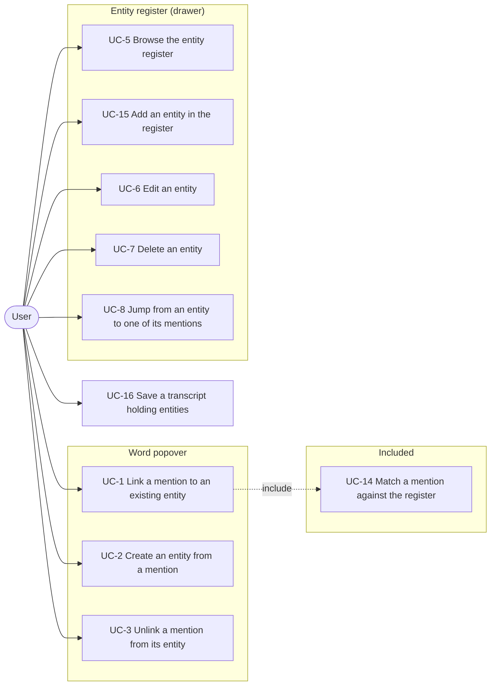
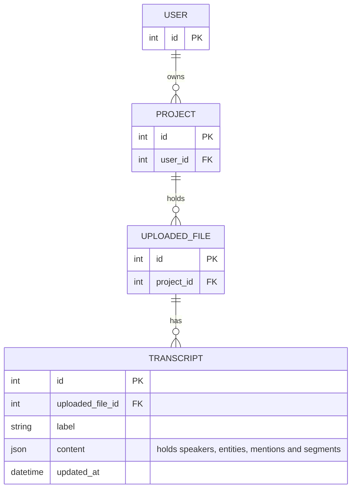
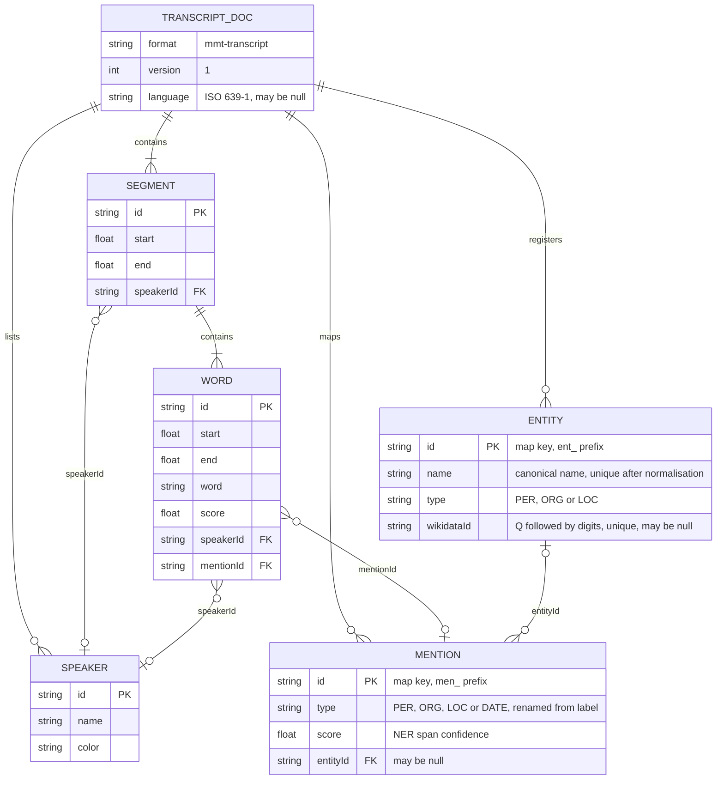

# Spec: canonical entities in the transcript

Status: in progress.

This document is an **executable spec** (spec-driven development): it is the
prompt an implementing session works from and the authoritative record of every
decision, not a background sketch. Resolve ambiguity by reading this document,
not by inventing; if a genuinely new decision comes up, write it into this
document as part of the task. Check off tasks (`[x]`, with date) as they land.
Do not duplicate CLAUDE.md conventions here (test-first, pytest style, vitest
for the frontend, both locale files for every new string).

The architectural overview that accompanies this spec is
[`docs/canonical-entities-architecture.md`](../docs/canonical-entities-architecture.md).
It records where the identity tier sits and why; this spec records what is
built. Where the two disagree, this spec is authoritative. The overview predates
the revision of 2026-09-26 (type equality, entities without mentions, unique
names) and is corrected in slice 3.

The file names, functions and components this spec refers to were checked
against the code on 2026-09-26. Since the spec was first written, the editor
store has been split into one composable per tier (`useMentions.ts`,
`useSpeakers.ts` and others), speaker changes are tracked without marking
segments dirty, the settings drawer shows checkboxes for the visibility of
each type instead of a static legend, and redactions have been implemented.

## Motivation

The transcript already records **mentions**: one entry in the transcript-level
`mentions` map per occurrence of a named entity, produced by the NER pass or by
hand in the word popover, with a type (`PER`, `ORG`, `LOC`, `DATE`) and a
confidence score. Words point at a mention through `mentionId`.

A mention is an occurrence, not an identity. "Angela Merkel" said three times in
an interview is three mentions, and nothing in the stored content says that the
three are the same person. "Merkel" said a fourth time is a fourth mention that
nothing connects to the other three. A user who wants to know where a person
appears in an interview, or who wants to attach a Wikidata identifier to a
person once instead of once per occurrence, cannot express that today.

This feature adds an identity tier: a transcript-level `entities` map holding a
canonical name, a type and an optional Wikidata identifier,
and a nullable `entityId` on each mention pointing at one of those entities.
It adds the interface for linking a mention to an entity, an entity register in
a drawer beside the transcript, and navigation from an entity to each of its
mentions.

`entityId: null` is a legal permanent state, not an unfinished task. Linking is
decoupled from mention creation: the NER pass and the word popover produce
unlinked mentions, and linking is a separate step the user performs.

An entity may exist without any mention. The register is a list of identities
the user has recorded for the transcript, and an identity keeps its name and
Wikidata identifier when its last mention is unlinked or when a new
NER pass replaces every mention.

## Non-goals

Do not add these, even where they would be easy:

- **No entity table in the database.** Entities live inside `Transcript.content`
  like speakers and mentions, and their scope is one transcript. Cross-transcript
  identity, meaning the same person recognised across interviews, is the trigger
  for a real database entity, and it is deferred by the same reasoning that
  defers a `Speaker` model in
  [`docs/mmt-transcript-format.md`](../docs/mmt-transcript-format.md).
- **No linkable DATE mentions.** `entity.type` is `PER`, `ORG` or `LOC` only,
  and the popover shows no entity row for a `DATE` mention. A date has no
  identity; making a date canonical means normalising it to a calendar value
  (ISO 8601 or EDTF), which is a different feature and would be a `value` field
  on the mention, not an entry in the entity register.
- **No coreference.** Pronouns and descriptions ("er", "der Zeitzeuge") are not
  mentions today, the NER service does not produce such spans, and this feature
  does not create them.
- **No silent entity creation.** No pass creates an entity on its own. Every
  entity in the register was created by an explicit user action: the combobox in
  the word popover or the add action in the register.
- **No automatic linking.** Every link is set by the user. There is no rule that
  links mentions on its own, no propagation of a link to identical mentions, no
  batch linking, no entity suggestions and no review queue. There is therefore
  no link-provenance field in the format.
- **No merging of entities.** A duplicate entity is repaired by relinking its
  mentions and deleting it.
- **No mention-provenance field.** Whether a mention came from the NER pass or
  from the word popover is not recorded. No use case in this feature reads it;
  see the open questions.
- **No aliases.** An entity has one name. A mention whose surface text differs
  from that name is linked by choosing the entity in the combobox. The
  `aliases` field of slice 1 is removed in slice 7.
- **No Wikidata lookup.** The `wikidataId` field exists from slice 1 and is
  typed by hand. Searching Wikidata for candidates and prefilling the name
  from its labels is purely additive interface work on a field that
  already exists, and it needs a decision about client-side against
  backend-proxied requests that is not made here.
- **No entity output in any export.** The export formats in
  [`2026-07-30-transcript-export.md`](2026-07-30-transcript-export.md) carry
  neither mentions nor entities, and this feature does not change that. TEI is
  the format with a natural place for them and it stays an open question there.
- **No entity data in the read-only API.** The API in
  [`2026-07-30-read-only-api.md`](2026-07-30-read-only-api.md) serves
  `Transcript.content` unchanged at
  `GET /api/v1/transcripts/{id}/content`, so entities reach an API client as
  part of that document without any change to the API. No entity-specific
  endpoint is added.
- **No relationship to redactions.**
  [`2026-07-26-redactions.md`](2026-07-26-redactions.md) makes no decision
  about entities, and no decision here anticipates redactions.
- **No format version bump.** See the format extension below.

## Actors

- **User** — a logged-in account holder with the
  `transcripts.change_transcript` permission, editing one transcript in the
  transcript editor. The actor in every use case.

## System use cases

The overview shows which actor triggers which use case. `<<include>>` marks a
use case that every dependent case performs as part of its own flow.



Each use case below is the authoritative description of one system behaviour.
The feature reference further down repeats the rules in a compact form; where
the two disagree, the feature reference is wrong and both are fixed together.

Every use case except UC-16 changes the editor's in-memory state only. Nothing
reaches the database until the user saves (UC-16).

### UC-1 Link a mention to an existing entity

- **Actor:** User.
- **Precondition:** The transcript is open in the editor, a word belonging to a
  mention with type `PER`, `ORG` or `LOC` is selected, and the mention has no
  entity.
- **Trigger:** The user opens the word popover, chooses an entity in the
  entity combobox's select and confirms it.
- **Main flow:**
  1. The popover's mention section shows an entity row holding a combobox whose
     query is prefilled with the mention's trimmed surface text (see
     "Normalisation").
  2. The system lists the register's entities ranked by the ranking rule, and
     preselects the entity that matches the mention (UC-14) when there is one.
  3. The user chooses an entity in the select and confirms it with the link
     action or with Enter in the input.
  4. The system sets the mention's `entityId` to that entity's identifier and
     marks the register as changed.
  5. The popover switches the entity row to its linked form, showing the
     entity's name, with actions to change the link and to unlink. The type
     and the Wikidata identifier are shown in the entity register only.
- **Alternative flow A — the entity's type differs from the mention's type:**
  The system sets the mention's `type` to the entity's type as part of step 4.
  Linking a mention to an entity of another type is the correction of the
  mention's type.
- **Alternative flow B — the mention's type is `DATE`:** No entity row is
  shown; there is nothing for the user to trigger.
- **Postcondition:** The mention's `entityId` names an entity in the register,
  and the mention's `type` equals the entity's `type`.

### UC-2 Create an entity from a mention

- **Actor:** User.
- **Precondition:** As UC-1.
- **Trigger:** The user activates the create button directly below the
  combobox input, which reads `Create "<query>"`.
- **Main flow:**
  1. The system creates an entity with a fresh identifier, the name taken from
     the combobox query as typed and trimmed, the type taken from the mention's
     `type` and no Wikidata identifier.
  2. The system links the mention to the new entity, exactly as in UC-1 step 4.
  3. The popover shows the linked form.
- **Alternative flow A — the normalised query equals the normalised name of
  any entity in the register, whatever its type:** The
  create button is not shown, because the register would violate invariant 4. The
  user picks the existing entity instead.
- **Alternative flow B — the query is empty after normalisation:** The create
  button is not shown.
- **Postcondition:** The register holds one more entity, referenced by the
  mention it was created from.

### UC-3 Unlink a mention from its entity

- **Actor:** User.
- **Precondition:** The selected word belongs to a linked mention.
- **Trigger:** The user activates the unlink action in the popover's entity row.
- **Main flow:**
  1. The system sets the mention's `entityId` to `null`. The mention keeps its
     `type`.
  2. The entity row returns to its unlinked form with the combobox.
- **Postcondition:** The mention has no entity. The entity stays in the
  register, also when no mention references it any more.

### UC-5 Browse the entity register

- **Actor:** User.
- **Precondition:** The transcript is open in the editor.
- **Trigger:** The user opens the entity drawer on the left of the transcript.
- **Main flow:**
  1. The drawer opens docked: the transcript shifts to make room, stays visible
     and stays editable, and no backdrop is drawn.
  2. The register lists every entity by name, each with a type swatch, its name,
     its type and the number of mentions pointing at it, which may be zero.
  3. A search field appears once the register holds more than eight entities and
     filters the list on the normalised name.
- **Alternative flow A — the register is empty:** The list is replaced by a
  sentence explaining that entities are added in the register or created by
  linking a mention in the word popover.
- **Alternative flow B — the viewport is narrower than the docked layout
  allows:** The drawer opens as an overlay with a backdrop, in the same way the
  existing settings drawer on the right does.
- **Postcondition:** None. Opening the drawer changes nothing. The register
  lists every entity whatever the type visibility checkboxes in the settings
  drawer are set to; those checkboxes affect only the colouring of the
  transcript.

### UC-6 Edit an entity

- **Actor:** User.
- **Precondition:** The register lists the entity.
- **Trigger:** The user activates the edit action on an entity row.
- **Main flow:**
  1. The row becomes a form holding the name, the type and the Wikidata
     identifier.
  2. The user changes any of them and confirms.
  3. The system writes the values to the entity and marks the register as
     changed.
- **Alternative flow A — the name is empty after normalisation:** Confirming is
  not possible; the entity keeps its values.
- **Alternative flow B — the Wikidata identifier does not match `Q` followed by
  digits:** Confirming is not possible and the field is marked as invalid. An
  empty field is valid and means no identifier.
- **Alternative flow C — the normalised name equals the normalised name of
  another entity:** Confirming is not possible, and the field is marked with
  "Another entity already has this name."
- **Alternative flow D — the Wikidata identifier is already held by another
  entity:** Confirming is not possible, and the field is marked with "Another
  entity already has this Wikidata ID."
- **Alternative flow E — the type changes:** The system sets the `type` of every
  mention linked to the entity to the new type, in the same step.
- **Postcondition:** The entity holds the new values, and every linked mention
  has the entity's type. Its identifier and the mentions pointing at it are
  unchanged, so a rename is one write.

### UC-7 Delete an entity

- **Actor:** User.
- **Precondition:** The register lists the entity.
- **Trigger:** The user activates the delete action on an entity row and
  confirms in place.
- **Main flow:**
  1. The system sets `entityId` to `null` on every mention pointing at the
     entity.
  2. The system removes the entity from the register.
- **Alternative flow A — the user cancels the confirmation:** Nothing changes.
- **Postcondition:** The mentions still exist, are still mentions, keep their
  type, and are unlinked. Deleting an entity never deletes a mention or a word.

### UC-8 Jump from an entity to one of its mentions

- **Actor:** User.
- **Precondition:** The register lists the entity.
- **Trigger:** The user expands an entity row and activates one of its mentions.
- **Main flow:**
  1. The expanded row lists the entity's mentions in document order, each with
     the start time of the mention's first word and a snippet of the surrounding
     words with the mention's own words marked.
  2. Activating a mention makes the system scroll the transcript so that the
     mention's segment is visible, mark that mention in the transcript as the
     focused one, and seek the media element to the start of the mention's first
     word without starting playback.
- **Alternative flow A — the user activates another mention:** The previous
  focus mark is removed and the new mention is marked. Exactly one mention is
  marked at a time, and the mark stays until the next jump.
- **Alternative flow B — the entity has no mention:** The expanded row shows
  "No mentions in this transcript." and nothing can be activated.
- **Postcondition:** None. Navigation changes no content.

### UC-14 Match a mention against the register

- **Actor:** Included by UC-1; never triggered on its own.
- **Precondition:** A mention and a register of entities.
- **Trigger:** Any of the including use cases.
- **Main flow:**
  1. The system computes the mention's surface text: the words of the whole
     document carrying that `mentionId`, in document order, joined with a single
     space.
  2. The system normalises that text (normalisation below).
  3. An entity matches when its `type` equals the mention's `type` **and** the
     normalised surface text equals the normalised entity name.
  4. The system returns the matching entity. Invariant 4 guarantees that at most
     one entity matches.
- **Alternative flow A — no entity matches:** The result is empty and the
  including use case leaves the mention unlinked.
- **Postcondition:** None. Matching writes nothing.

### UC-15 Add an entity in the register

- **Actor:** User.
- **Precondition:** The entity drawer is open.
- **Trigger:** The user activates "Add entity" in the register.
- **Main flow:**
  1. The register shows a form holding a name input and a type selector with
     `PER`, `ORG` and `LOC`, defaulting to `PER`.
  2. The user enters a name, picks a type and confirms.
  3. The system creates an entity with a fresh identifier, the trimmed name, the
     chosen type and no Wikidata identifier, and marks the register as changed.
  4. The new entity appears in the list with a mention count of zero. The
     Wikidata identifier is added through UC-6.
- **Alternative flow A — the name is empty after normalisation, or equals the
  normalised name of an existing entity:** Confirming is
  not possible, with the same messages as UC-6.
- **Alternative flow B — the user cancels:** Nothing changes.
- **Postcondition:** The register holds one more entity, referenced by no
  mention. The combobox preselects it for a mention it matches (UC-1).

### UC-16 Save a transcript holding entities

- **Actor:** User.
- **Precondition:** The editor holds unsaved changes, whether to segments, to
  words, or to the register alone.
- **Trigger:** The user activates the save action in the document bar.
- **Main flow:**
  1. The editor posts the content including the `entities` map and each
     mention's `entityId` to the existing update route.
  2. The backend validates it with `validate_mmt_content`, which also checks
     the entity invariants below, and stores the validated model.
  3. The editor clears its unsaved state, including the register's.
- **Alternative flow A — a change to the register or to a link is the only
  change:** The save action is enabled and the document bar shows "Unsaved
  changes", as it does for a change to the speakers alone. The change is
  tracked by `entitiesAreDirty` in the same way as `speakersAreDirty`; without
  it the change could not be saved, since the other dirty flags live on
  segments, words, speakers and the label.
- **Alternative flow B — the content fails validation:** The existing behaviour
  applies: the route answers `400` with the messages and the editor keeps its
  unsaved state. A dangling `entityId`, a type mismatch or a duplicate name
  reaching this point is a bug in the editor, not user input.
- **Postcondition:** `Transcript.content` holds the register and the links.

## Entity relationship model

Two diagrams. The first is the persisted graph, which this feature does not
change: entities are not a table. The second is the structure inside the
`content` column, which is where the whole feature lives.

### Persisted entities



Ownership is checked on the path the editor's routes already use:
`Transcript.objects.filter(pk=..., uploaded_file__project__user=user)`. This
feature adds no model and no query. It adds one data migration, which renames
the mention field `label` to `type` inside stored content.

### Structure of `Transcript.content`

The mmt-transcript document as defined in
[`app/mmt/transcripts/mmt_schema.py`](../app/mmt/transcripts/mmt_schema.py) and
described in [`docs/mmt-transcript-format.md`](../docs/mmt-transcript-format.md),
with `ENTITY` and the `entityId` reference added by this feature. Relations are
containment and reference within one JSON document, not foreign keys.



The cardinality of the new relation is the whole design: a mention points at
zero or one entity, and an entity is pointed at by zero or more mentions. The
zero on the mention side is the permanent legal state of an undisambiguated
mention; the zero on the entity side is an identity that the user has recorded
and that has no occurrence in the current mentions.

### Invariants

The strict validator enforces these, in addition to the ones it enforces today:

1. Entity identifiers are unique across every identifier in the document, in
   the same namespace as speaker, mention, segment and word identifiers.
2. Every `mention.entityId` that is not `null` resolves to a key of `entities`.
3. Every linked mention has the `type` of its entity.
4. Across the whole register, whatever the type, no two normalised names are
   equal, and none of them is empty.
5. No two entities carry the same `wikidataId`.

The validator deliberately does **not** enforce these:

- **An entity is referenced by a mention.** An entity without mentions is
  legal (see the motivation).
- **A type-to-type relationship for `DATE`.** A `DATE` mention simply never
  carries an `entityId`, because no entity has that type and invariant 3 would
  reject a link to anything else.

Invariants 4 and 5 are strict on purpose. Loosening either later, for example
to allow "Berlin" as both a `LOC` and an `ORG` entity, is backward compatible;
tightening it later would reject stored content.

## Feature reference

### Format extension

The format extends version 1 **in place**. There is no version bump.

The extension does not keep documents stored before it valid. `entities` is
required, like `speakers` and `segments`, so a document written before the field
existed is rejected by the validator. There is no upgrade path either:
`normalize_content` re-validates content that already carries
`format: "mmt-transcript"` rather than upgrading it, so `normalize_transcripts`
reports such a row as invalid and skips it. The format is in its development
phase, and breaking those rows is cheaper than carrying a default whose only
purpose is to accept the old shape.

`entityId` is defaulted rather than required, in the same way as `score` on a
mention and `mentionId` on a word: an absent key means `null`, which is the
state of an unlinked mention. This is a property of the field, not a concession
to content stored earlier.

The mention field `label` is renamed to `type`. The entity and the mention hold
the same value from the same vocabulary, and invariant 3 makes them equal on
every linked mention, so they carry the same name. `label` is not used for it,
because in Wikidata a label is a name, and `Transcript.label` is the title of a
transcript. The rename is done by the data migration
`app/mmt/transcripts/migrations/0007_rename_mention_label_to_type.py`, a
`RunPython` operation that renames the key in every mention of every
`Transcript.content` and whose reverse operation renames it back. The field of
the NER service's response spans stays `label`; `apply_mention_spans` writes it
into `type`. The rename changes the document that the read-only API serves,
which is accepted during the development phase.

The version stays at `1` regardless: a bump exists to trigger a migration of
stored content through the format's own upgrade path, and this change uses a
database migration instead.

The sentence in
[`docs/mmt-transcript-format.md`](../docs/mmt-transcript-format.md) that calls a
future `entities` map "a `version: 2` event" was corrected in slice 1. That
correction states the rule that holds from then on: once the format leaves the
development phase, an additive change to an `extra: forbid` schema is again a
version-bump event.

```jsonc
{
  "format": "mmt-transcript",
  "version": 1,
  "speakers": [ /* unchanged */ ],
  "entities": {
    "ent_9c2f4d1e8b6a4f0f9c1d2e3f4a5b6c7d": {
      "name": "Angela Merkel",
      "type": "PER",
      "wikidataId": "Q567"
    },
    "ent_4b7e...": {
      "name": "Helmut Kohl",
      "type": "PER",
      "wikidataId": null
    }
  },
  "mentions": {
    "men_7f3a...": { "type": "PER", "score": 0.93, "entityId": "ent_9c2f..." },
    "men_8b1c...": { "type": "PER", "score": 0.88, "entityId": null }
  },
  "segments": [ /* unchanged */ ]
}
```

The second entity has no mention, which is legal.

### Blank words

`Word.word` must contain at least one character that is not whitespace. The
field gets `pattern=r'\S'`, which pydantic matches anywhere in the value, so a
word consisting only of whitespace is rejected. A blank `Entity.name`
needs no separate check: its normalised form is empty, which invariant 4
rejects. The schema does not rewrite stored text; every value that passes
validation is stored as posted.

### Schema

```python
# mmt/transcripts/mmt_schema.py
EntityId = Annotated[str, StringConstraints(min_length=1)]
EntityType = Literal['PER', 'ORG', 'LOC']


class Entity(BaseModel):
    model_config = ConfigDict(extra='forbid')

    name: str = Field(min_length=1)
    type: EntityType
    wikidataId: str | None = Field(default=None, pattern=r'^Q[1-9][0-9]*$')


class Mention(BaseModel):
    model_config = ConfigDict(extra='forbid')

    type: Literal['PER', 'ORG', 'LOC', 'DATE']
    score: float = Field(default=1.0, ge=0, le=1)
    entityId: str | None = None


class Transcript(BaseModel):
    ...
    entities: dict[EntityId, Entity]
```

`_relations` on `Transcript` checks the invariants, following the shape of the
checks that are there: entity identifiers go through the existing `claim()` so
they share one namespace with every other identifier; each non-null `entityId`
is resolved against `self.entities`; a linked mention whose type differs raises
`mention <id>: type <type> differs from the type <type> of entity <id>`; a
second entity with the same `wikidataId` raises
`entity <id>: wikidataId <id> is already used by entity <id>`; and a normalised
name that is empty or already seen raises
`entity <id>: name <value> is empty or not unique after normalisation`.
The uniqueness check imports `normalized_surface` from `entity_linking.py`.
The orphaned-entity check of slice 1 is removed.

The Wikidata pattern rejects `Q0` and leading zeros, since neither is a Wikidata
identifier, and it is anchored so that a whole label ("Q567 (Angela Merkel)")
is rejected rather than partly accepted.

### Identifiers

Entity identifiers use the existing scheme. The backend mints them with
`_new_id('ent')` from
[`app/mmt/transcripts/normalize.py`](../app/mmt/transcripts/normalize.py),
producing `ent_<uuid4 hex>`; the editor mints them with `newId` from `new_id.ts`,
producing `ent_<crypto.randomUUID()>`. The two spellings differ in
punctuation and both are opaque strings that only have to be unique, which is
already true of the mention and word identifiers the two sides mint today.

### Surface text of a mention

A mention's surface text is every word of the **whole document** carrying that
`mentionId`, in document order, joined with a single space.

The existing `mentionText(segmentIndex, mentionId)` in `useMentions.ts` is
scoped to one segment, which is correct for the popover's extend and reduce
actions but wrong for a mention that crosses a segment boundary. The editor
never produces such a mention, since it refuses to split a segment inside a
mention, but `apply_mention_spans` does when an NER span crosses a boundary,
and the format allows it. Slice 5 adds a document-wide
`mentionSurface(mentionId)` to `useMentions.ts` and uses it everywhere the
identity of a mention is at stake: the combobox query and the register. `mentionText` stays for the popover's mention title,
because it reads one segment instead of the whole document; a future invariant
that excludes mentions crossing a segment boundary would make it exact for
every mention.

The backend equivalent is `mention_surfaces(content) -> dict[str, str]`, which
walks the document once and returns the surface text of every mention.

### Normalisation

One rule, implemented twice, verified against one file of shared test cases:

1. Apply Unicode normalisation form NFKC.
2. Replace every run of whitespace with a single space and remove leading and
   trailing whitespace.
3. Remove leading and trailing characters whose Unicode general category starts
   with `P` (punctuation) or `S` (symbol), repeatedly until the first and last
   character are neither, then remove whitespace again.
4. Lowercase.

```python
# mmt/transcripts/entity_linking.py
def normalized_surface(text: str) -> str: ...
```

```ts
// assets/js/transcript/entity_matching.ts
export function normalizedSurface(text: string): string;
export function trimmedSurface(text: string): string;
```

`trimmedSurface` applies steps 2 and 3 only and keeps the case and the Unicode
form of the text. It produces the proposed entity name that prefills the
combobox (UC-1), so "Merkel," and „Merkel“ are proposed as `Merkel`.
`normalizedSurface` applies step 1, passes the result to `trimmedSurface`, and
then applies step 4, so the stripping is implemented once. A name that ends in
punctuation, such as "Inc.", loses it in the prefill and is typed again by the
user. `trimmedSurface` has no backend counterpart, because no backend function
proposes a name.

Lowercasing uses Python's `str.lower()` and JavaScript's `toLowerCase()`.
Python's `str.casefold()` is the better rule for a single-language matcher, but
it maps `ß` to `ss` while `toLowerCase()` does not, and the two implementations
of this rule must agree on every input. A rule that behaves identically on both
sides is worth more than the additional match between "Straße" and "STRASSE".

Interior punctuation is kept, so "O'Brien" and "St. Pauli" normalise to
`o'brien` and `st. pauli`. Only the edges are stripped, which is what removes
the comma and the full stop that a spoken mention picks up from the surrounding
sentence.

The shared cases live in
`app/mmt/transcripts/tests/data/normalization_cases.json`, a list of
`{"input": ..., "expected": ...}` objects. The pytest test iterates it; the
vitest test imports it with a relative path, which requires adding
`"resolveJsonModule": true` to `app/tsconfig.json`. The file lives under the
backend because the backend owns the format and the rule; the frontend
implementation follows it.

The cases, at minimum:

| Input | Normalised |
| --- | --- |
| `Angela Merkel` | `angela merkel` |
| `MERKEL` | `merkel` |
| `  Angela   Merkel ` | `angela merkel` |
| `Merkel,` | `merkel` |
| `„Merkel“` | `merkel` |
| `(Merkel)` | `merkel` |
| `Merkel!?` | `merkel` |
| `Angela` + U+00A0 (no-break space) + `Merkel` | `angela merkel` |
| `ff` (U+FB00, the ff ligature) | `ff` |
| `O'Brien` | `o'brien` |
| `St. Pauli` | `st. pauli` |
| `Bundesrepublik€` | `bundesrepublik` |
| `...` | `` (empty) |
| `` | `` |

### Match rule

**Rule A, register match.** Used by UC-14, and therefore by the combobox
preselection. A
mention matches an entity when `mention.type == entity.type` and the normalised
surface text equals the normalised `entity.name`. Invariant 4 makes the result unique.

```python
def matching_entity(surface: str, type: str, entities: dict) -> str | None:
    """Identifier of the entity that rule A matches, or None."""
```

Rule A never sets a link. A link is set only by the user confirming an entity
in the combobox.

### Ranking in the combobox

The list is ordered by these groups, and within a group by name using
`localeCompare` with the document's language:

1. The entity that rule A matches.
2. Entities whose normalised name starts with the normalised query.
3. Entities whose normalised name contains the normalised query.
4. Entities whose normalised name shares at least one word with the
   normalised query, ordered by the number of shared words, the highest first,
   and by name within an equal number. A word is a part of a normalised text
   between single spaces, and the number counts each distinct word of the
   query once if it occurs in the name. This group exists for
   a mention such as "Frau Arendt" of the entity "Hannah Arendt", whose texts
   neither start with nor contain each other.
5. Every other entity.

A shared word makes an entity a candidate only; preselection stays limited to
the rule A match.

The combobox is built from native elements, from top to bottom:

1. A text input holding the query. Every change of the query re-ranks the
   select's options and selects the entity that rule A matches, or the empty
   option when none matches.
2. The create button, directly below the input, so that it is visible without
   opening the select. UC-2 alternative flow A or B suppresses it.
3. A `<select>` in its dropdown form, beside a link action. Its first option is
   empty and reads "Not linked"; the ranked entities follow. Each option shows
   the entity's type swatch, name and type, since picking an entity of another
   type changes the mention's type (UC-1 alternative flow A). The select uses
   `appearance: base-select` so that an option can hold the swatch; a browser
   without support shows the option text "Name (Type)" and no swatch.

Choosing an option does not link. The link action, or Enter in the input,
confirms the selected entity and is disabled while the empty option is
selected. A closed native select changes its value on the arrow keys, so
linking on every change would link the mention on every key press. When rule A
matches an entity, that entity is selected, so that confirming the prefilled
query is one keystroke. When the change action reopens the combobox for a
linked mention, the combobox receives the current entity as `entityId` and
selects it instead, until the first change of the query. Escape in the input or
the select cancels.

### The word popover

The entity row is part of the existing mention section and is shown only when
`mention.type` is `PER`, `ORG` or `LOC`.

- **Unlinked:** the label "Entity", the combobox with the query prefilled with
  `trimmedSurface` of the mention's surface text. The existing type selector of the mention section
  is shown and edits `mention.type`.
- **Linked:** the entity's name, a change action reopening the combobox, and
  the unlink action. The
  type selector is hidden, because the type of a linked mention is the type of
  its entity and is changed on the entity (UC-6).

### Type of a linked mention

The type is stored on both the entity and the mention, and invariant 3 keeps
them equal. The alternative, a type stored only on the entity with
`mention.type` left empty on linked mentions, would make every reader of a
mention, including API clients, look up the entity to learn the type. Storing
it twice and checking the equality in the validator keeps the mention
self-contained.

The editor keeps the two equal in the store mutations that change either side:
`linkMention` sets the mention's type to the entity's type, and `updateEntity`
with a changed type sets it on every linked mention.

Slice 2 renames the frontend names that refer to the mention category:
`mentionLabel` becomes `mentionType` and `setMentionLabel` becomes
`setMentionType` in `useMentions.ts`, the `label` parameter of
`createMention` becomes `type`, and `ENTITY_LABELS` in `entities.ts` becomes
`ENTITY_TYPES`. `mentionType` returns `mention.type`; `transcript_word.vue`
uses it for the entity colouring of words, which needs no lookup of the entity.

### Marking of linked mentions

The transcript shows whether a mention is linked, so that the progress of
linking is visible without opening the register. `transcript_word.vue` gives every word
of a shown mention whose type is `PER`, `ORG` or `LOC` one of two classes:

- `transcript-word--linked` when the mention has an entity: the fill in the
  type colour and a solid 1px outline slightly darker than the fill.
- `transcript-word--unlinked` when it has none: a lighter fill of the same hue
  and a dashed 1px outline.

A `DATE` mention gets neither class, because it is never linked, and keeps the
plain fill. The outline encloses the whole run of a multi-word mention, with no
borders between its words. An underline is not used, because the orange
underline already marks an edited word.

### The entity drawer

`transcript_drawer.vue` gains three props:

```ts
defineProps<{
    label: string;               // the text of the tab
    side?: "left" | "right";     // default "right"
    mode?: "overlay" | "docked"; // default "overlay"
}>();
```

The tab currently shows the fixed text `$t("settings")`; the `label` prop
replaces it, and `transcript_table.vue` passes `$t('settings')` to the
settings drawer and `$t('entities')` to the entity drawer. The settings drawer
otherwise keeps the defaults and does not change. The entity register uses
`side="left" mode="docked"`, and `transcript_table.vue` places it beside the
existing `TranscriptDrawer`.

- `side` mirrors the fixed position, the tab, the border radius of the tab and
  the transform used to slide the panel, through the modifier classes
  `transcript-drawer--left` and `transcript-drawer--right`.
- `mode="docked"` draws no backdrop, so the transcript keeps receiving pointer
  events and the user edits with the register open. The transcript container
  receives a left padding equal to the drawer's width while a docked left drawer
  is open, so that the content shifts instead of being covered.
- In `mode="docked"` the Escape key does not close the drawer. The user works
  in the transcript and in the register's forms while the drawer is open, and
  Escape already cancels the combobox and the popovers there. The drawer is
  closed with its close button. In overlay mode, including the narrow-viewport
  fallback, Escape closes the drawer as it does today.
- Below `64rem` viewport width a docked drawer behaves as an overlay, with the
  backdrop, because shifting the content is not possible on a narrow screen.
  This is the first width media query in the stylesheet; it uses `rem` because
  `rlh` is not valid in a media query, which is the one exception to the `rlh`
  rule in CLAUDE.md.

The "Named entities" section with the type visibility checkboxes stays in the
settings drawer in `transcript_sidebar.vue`. An earlier version of this spec
moved it into the entity drawer; that decision was withdrawn on 2026-10-14.
The register's type swatches take their colours from `entityMeta` in
`entities.ts`, as the checkboxes' swatches do.

The drawer lands in slice 4 together with the read-only register list. Slice 8 adds the actions that change the register.

### The register

The list is sorted by name with `localeCompare`. Each row has two lines:

1. The type swatch coloured from the `--entity-*-bg` custom properties and the
   name in bold. The line does not wrap and a long name is cut off with an
   ellipsis. The full name is the `title` of that line.
2. Muted and smaller: the type, the mention count as `{count}×`, which may be
   `0×`, and the Wikidata identifier as a link to
   `https://www.wikidata.org/wiki/<id>`, separated by ` · `. An entity without
   a Wikidata identifier shows type and count only. The count carries the full
   phrase ("3 mentions") as its `title` and `aria-label`, so the word
   "mentions" is not repeated in every row.

Every even row has the background `--surface-hover`, so that the two lines of
one entity read as a unit. A search field appears once the register
holds more than eight entities and filters on the normalised name with a
containment test.

Above the list: the "Add entity" action (UC-15).

Adding (UC-15) shows a form above the list with a name input and a type
selector. Editing (UC-6) turns the row into a form. Both forms check the name
against the other entities with `normalizedSurface` and disable confirming on a collision, so
invariant 4 cannot be violated from the interface.

Deleting (UC-7) confirms in place with the `icon-button` pattern the speaker
legend already uses, not with a modal dialog.

### Concordance navigation

An expanded entity row lists the entity's mentions in document order. Each entry
shows the start time of the mention's first word, formatted by the existing
timecode component, and a snippet: up to five words before and five words after
the mention within its segment, with the mention's own words marked, and an
ellipsis where the snippet was cut. An entity without mentions shows "No
mentions in this transcript." instead.

Activating an entry:

makes `entity_register.vue` emit a `jump` event carrying the entry's
`MentionRef`. `transcript_table.vue` handles the event in `jumpToMention`,
which

1. sets `focusedMentionId` in the store to that mention,
2. seeks the media element to the start of the mention's first word with
   `seekTo` on the media store, which does not start playback, exactly as
   clicking a segment does today,
3. scrolls the mention's segment into view with
   `scrollIntoView({ behavior: "smooth", block: "center" })`, through the
   same `segmentRefs` lookup that `jumpToCurrentSegment` already uses. That
   lookup is extracted into `scrollToSegment(segmentIndex)`, which both
   functions call.

The scroll is a direct call in response to the event, not a watcher on
`focusedMentionId`, so that a second jump to the same mention scrolls again,
and so that the scroll does not depend on the `autoScroll` setting.

`focusedMentionId` also drives a `transcript-word--focused-mention` class on the
words of that mention, so the target of the jump is visible after the scroll.
The class is applied whether or not the mention's type is switched on in the
visibility checkboxes. The mark stays until the next jump; there is no timer.

### The store

`transcript_store.ts` holds the shared state (`segments`, `speakers`,
`mentions`, `entities`, `redactions`) and exposes the operations of one
composable per tier. The `entities` ref already exists since slice 1. The
entity operations go into a new composable, `useEntities.ts`, which receives
`segments`, `mentions` and `entities` and follows the shape of
`useSpeakers.ts`: it owns a dirty flag and the functions that load the state
and mark it saved.

`useMentions.ts` grows `mentionSurface`, and its `mentionLabel` and
`setMentionLabel` are renamed as described under "Type of a linked mention".

```ts
// useMentions.ts
function mentionType(mentionId?: string | null): string | null;
function setMentionType(segmentIndex: number, mentionId: string, type: string): void;
function mentionSurface(mentionId: string): string;

// useEntities.ts
const entitiesAreDirty = ref(false);

function loadEntities(map: Record<string, Entity>): void;   // clears the flag
function markEntitiesSaved(): void;
function entity(entityId?: string | null): Entity | null;
function mentionCount(entityId: string): number;
function mentionsOfEntity(entityId: string): MentionRef[];   // document order
function createEntity(name: string, type: EntityType): string;  // returns the id
function linkMention(mentionId: string, entityId: string): void;
function unlinkMention(mentionId: string): void;
function updateEntity(entityId: string, values: Partial<Entity>): void;
function deleteEntity(entityId: string): void;
```

`MentionRef` carries what every caller of these lists needs without a second
lookup: `{ mentionId, segmentIndex, segmentId, start, surface, type }`.

`linkMention` and `updateEntity` keep invariant 3 as described under "Type of a
linked mention". `unlinkMention` and `deleteEntity` leave the entity's other
data untouched and remove nothing but the links, apart from `deleteEntity`
removing the entity itself.

`pruneOrphans` in `prune_orphans.ts` currently removes every entity that no
mention references, after removing the mentions that no word references. Slice
3 removes the entity step, so that `pruneOrphans` removes mentions and
redactions only. An entity whose last mention is removed through
`removeMention`, `reduceMention` or the removal of a word stays in the
register. `pruneOrphans` then no longer needs the `entities` parameter.

Every mutation in `useEntities.ts` sets `entitiesAreDirty`, including the ones
that only change a mention's `entityId` or `type`. They do not mark any
segment dirty, in the same way as speaker changes. `transcriptIsDirty` in the
store gains `|| entityOperations.entitiesAreDirty.value`, and `markSaved`
calls `markEntitiesSaved`. `markSaved` already runs only after the server
accepted the save. The document bar needs no change: it shows "Unsaved
changes" whenever `transcriptIsDirty` is true.

### Loading and saving

`loadTranscript` in `transcript_table.vue` currently assigns
`entities.value = json.entities`. Slice 6, the first slice with an entity
mutation, replaces the assignment with `store.loadEntities(json.entities)`, as
the speakers are loaded with `store.loadSpeakers`, so that loading and
discarding clear `entitiesAreDirty`. There is no fallback for a missing key:
such content does not validate and is not supported, and the editor does not
compensate for it.

`saveTranscript` in `transcript_table.vue` already sends `entities` alongside
`speakers` and `mentions`. `cleanTranscript` is unchanged: it strips the
editor's `dirty` markers from segments and words, and entities carry none.

### Translations

New vue-i18n keys, flat with an `entity_` prefix, in both
[`en.js`](../app/assets/js/locales/en.js) and
[`de.js`](../app/assets/js/locales/de.js). The existing keys `entity_type`
("Type"), `entity_per`, `entity_org`, `entity_loc` and `named_entities` are
reused and not added again:

| Key | English | German |
| --- | --- | --- |
| `entity_section` | Entity | Entität |
| `entities` | Entities | Entitäten |
| `entity_none` | Not linked | Nicht verknüpft |
| `entity_search_or_create` | Search or create… | Suchen oder anlegen… |
| `entity_create` | Create “{name}” | „{name}“ anlegen |
| `entity_link` | Link | Verknüpfen |
| `entity_change` | Change entity | Entität wechseln |
| `entity_unlink` | Unlink | Verknüpfung lösen |
| `entity_add` | Add entity | Entität hinzufügen |
| `entity_name` | Name | Name |
| `entity_name_taken` | Another entity already has this name. | Eine andere Entität hat bereits diesen Namen. |
| `entity_wikidata_id` | Wikidata ID | Wikidata-ID |
| `entity_wikidata_taken` | Another entity already has this Wikidata ID. | Eine andere Entität hat bereits diese Wikidata-ID. |
| `entity_mention_count` | {count} mention \| {count} mentions | {count} Erwähnung \| {count} Erwähnungen |
| `entity_mention_count_short` | {count}× | {count}× |
| `entity_no_mentions` | No mentions in this transcript. | Keine Erwähnungen in diesem Transkript. |
| `entity_edit` | Edit entity | Entität bearbeiten |
| `entity_delete` | Delete entity | Entität löschen |
| `entity_delete_confirm` | : delete? Its mentions stay. | : löschen? Die Erwähnungen bleiben erhalten. |
| `entity_register_empty` | No entities yet. Add one here or link a mention in the word popover. | Noch keine Entitäten. Fügen Sie hier eine hinzu oder verknüpfen Sie eine Erwähnung im Wort-Popover. |
| `entity_search` | Search entities | Entitäten suchen |

The whole feature is in the Vue editor, so no Django template string and no
`django.po` entry is added. If a slice does add one, the CLAUDE.md rule applies:
German translation and `compilemessages` in the same session.

## File layout

```
app/mmt/transcripts/
    mmt_schema.py                        Entity, Mention.type and entityId,
                                         Word.word pattern, extended _relations
    entity_linking.py                    normalisation, surfaces, rule A
    normalize.py                         apply_mention_spans writes type; _new_id('ent')
    migrations/0007_rename_mention_label_to_type.py
    migrations/0009_remove_entity_aliases.py
    tests/
        data/normalization_cases.json    shared with the vitest suite
        test_apply_mention_spans.py      extended: spans are written as type
        test_entity_linking.py
        test_mmt_schema.py               extended
        test_migrations.py               the label-to-type rename, both directions
        test_views.py                    extended

app/assets/js/transcript/
    types.ts                 Entity, EntityType, Mention.type, Mention.entityId
    entity_matching.ts       normalizedSurface, matchingEntity, rankEntities
    entity_matching.test.ts
    entity_combobox.vue      select-or-create in the word popover
    entity_combobox.test.ts
    entity_register.vue      the drawer contents: list, add, edit, delete
    entity_register.test.ts
    entity_mention_list.vue  the concordance of one entity
    entities.ts              ENTITY_LABELS renamed to ENTITY_TYPES
    useEntities.ts           entitiesAreDirty and the entity operations above
    useMentions.ts           mentionType, setMentionType, mentionSurface
    prune_orphans.ts         no longer removes entities
    word_popover.vue         entity row
    transcript_drawer.vue    label, side and mode props
    transcript_word.vue      link marking, focus mark
    transcript_table.vue     the entity drawer, loadEntities, jumpToMention, scrollToSegment
    transcript_store.ts      exposes useEntities, extends transcriptIsDirty and markSaved

app/assets/css/components/
    entity_register.css
    transcript_drawer.css    left and docked modifiers
```

Key signatures:

```python
# mmt/transcripts/entity_linking.py
def normalized_surface(text: str) -> str: ...
def mention_surfaces(content: dict) -> dict[str, str]: ...
def matching_entity(surface: str, type: str, entities: dict) -> str | None: ...
```

```ts
// assets/js/transcript/entity_matching.ts
export function normalizedSurface(text: string): string;
export function trimmedSurface(text: string): string;
export function matchingEntity(
    surface: string,
    type: string,
    entities: Record<string, Entity>,
): string | null;
export function rankEntities(
    query: string,
    type: string,
    entities: Record<string, Entity>,
    language?: string | null,                  // the document's language, for localeCompare
): RankedEntity[];

export interface RankedEntity {
    id: string;
    entity: Entity;
    exactMatch: boolean;                       // the rule A match, which the combobox preselects
}
```

## Tests

Backend, pytest style:

- `test_entity_linking.py` — `normalized_surface` against every shared case;
  `mention_surfaces` for a single-word mention, a multi-word mention and a
  mention crossing a segment boundary; `matching_entity` for a name match, a case and punctuation difference, and a type that differs from
  the entity's type (no match).
- `test_mmt_schema.py` — a valid register validates; an entity without
  mentions validates; a `mention.entityId` naming no entity is rejected; a
  linked mention whose type differs from its entity's type is rejected; an
  entity identifier colliding with a mention or speaker identifier is rejected;
  `type: "DATE"` on an entity is rejected; a `wikidataId` of `Q0`, `567` or
  `Q567x` is rejected and `Q567` and `null` are accepted; two entities with the
  same `wikidataId` are rejected; two entities whose names differ only in case
  and edge punctuation are rejected, also when their types differ; an entity
  carrying an `aliases` key is rejected; a name of `...` is rejected; a word
  consisting only of whitespace is rejected.
- `test_migrations.py` — the migration renames `label` to `type` in every
  mention of stored content, and the reverse operation renames it back; the
  migration `0009_remove_entity_aliases.py` removes the `aliases` key from
  every entity of stored content, and the reverse operation adds an empty
  `aliases` list.
- `test_views.py` — the update route answers `400` for content with a dangling
  `entityId` and `200` for a valid register; the individual invariants are
  covered by `test_mmt_schema.py`.

Frontend, vitest:

- `entity_matching.test.ts` — `normalizedSurface` against the same shared
  cases file, so the two implementations cannot drift; `matchingEntity` for
  the same cases as the backend; `rankEntities` for the shared-word group and
  its order by the number of shared words; `trimmedSurface` keeping case and interior
  punctuation ("St. Pauli," and „Merkel“ become `St. Pauli` and `Merkel`);
  `rankEntities` for the group order and the preselected exact match.
- `transcript_store.test.ts` — `createEntity` mints an identifier and returns
  it; `linkMention` sets `entityId`, sets the mention's type to the entity's
  type and sets `entitiesAreDirty` without marking a segment dirty;
  `transcriptIsDirty` is true while only `entitiesAreDirty` is set, and
  `markSaved` clears it; `unlinkMention` keeps the entity also when it
  lost its last mention; `updateEntity` with a new type changes the type of
  every linked mention; `deleteEntity` unlinks its mentions and keeps them as
  mentions with their type; `mentionSurface` joins across a segment boundary;
  removing the last mention of an entity with `removeMention` keeps the entity.
- `entity_combobox.test.ts` — the exact match is preselected and nothing is
  selected without one; typing re-ranks the options and moves the selection;
  the create button emits the trimmed query and is absent for a query equal to
  the name of an entity of any type and for an empty query; the link
  action emits the selected entity and is disabled with none selected; Enter
  in the input links the selected entity and does nothing with none; a given
  `entityId` is selected until the query changes; Escape cancels.
- `word_popover.test.ts` — no entity row for a `DATE` mention; the combobox,
  prefilled with the trimmed surface text, and the type selector in the
  unlinked state; the change action passing the current entity to the
  combobox; the entity's name in the linked state, without the type
  selector.
- `entity_register.test.ts` — sorting by name, the mention counts including
  zero, the Wikidata identifier as a link only when the entity has one, the
  search field appearing above eight entities, the add form creating an entity without mentions, the add and edit
  forms rejecting an empty name, a name taken by another entity, a malformed
  Wikidata identifier and a Wikidata identifier taken by another entity, and
  the delete confirmation.
- `transcript_word.test.ts` — extended: a linked mention gets the linked class,
  an unlinked one the unlinked class, and a `DATE` mention neither.
- `transcript_drawer.test.ts` — extended: the tab shows the `label` prop, the
  left and docked modifier classes, no backdrop in docked mode, Escape leaving a
  docked drawer open, and the existing right overlay behaviour unchanged.
- `transcript_table.test.ts` — extended: a `jump` event from the register sets
  the focused mention, seeks the media to the mention's first word without
  starting playback, and scrolls the mention's segment into view, also with
  auto-scroll off.

## Slices and tasks

Each slice leaves the system working and independently deployable. Each task is
one session. The order was revised on 2026-09-26. The former slices 9 to 12
(merge, propagation after a manual link, the backend link pass, batch actions
and the review queue) were removed on 2026-10-16. Aliases were removed on the
same day; slice 7 removes them from the code, and the former slices 7 and 8
became slices 8 and 9.

- [x] 2026-08-05 **1 Format extension.** The `Entity` model, `entityId` on `Mention`,
  `entities` on `Transcript`, the three relational checks, the `Entity` and
  `EntityType` types in `types.ts`, loading and saving the map untouched in the
  editor, and the corrections to `mmt-transcript-format.md`. No interface.
  Done when the extended `test_mmt_schema.py` and the update-route tests in
  `test_views.py` pass, and a transcript whose content carries the map opens,
  saves and comes back with its register unchanged.
- [x] 2026-09-26 **2 Rename `label` to `type` on mentions.** The schema field, the data
  migration `0007_rename_mention_label_to_type.py`, `apply_mention_spans`, and
  every frontend name listed under "Type of a linked mention": `types.ts`,
  `useMentions.ts`, `entities.ts`, `word_popover.vue`, `transcript_word.vue`,
  `transcript_sidebar.vue` and `transcript_table.vue`, with their tests; and the
  field description in `mmt-transcript-format.md`.
  Done when `test_migrations.py`, `test_apply_mention_spans.py` and the
  existing schema, task and frontend tests pass with the new name, and a
  development run shows a migrated transcript with its entity colours and type
  checkboxes working as before.
- [x] 2026-10-02 **3 Revised invariants and blank words.** The `Word.word` pattern;
  invariant 3 (type equality) and invariant 5 (unique
  `wikidataId`); removal of the orphaned-entity check in the validator and of
  the entity step in `prune_orphans.ts`; the description of both in
  `mmt-transcript-format.md`; and the correction of
  `docs/canonical-entities-architecture.md` to type equality and entities
  without mentions.
  Done when the extended `test_mmt_schema.py` cases for these rules pass, and
  the store test for `removeMention` keeping the entity passes.
- [x] 2026-10-14 **4 The drawer and the register list.** `label`, `side` and `mode` props
  on `transcript_drawer.vue`, the left and docked CSS with the narrow-viewport
  fallback, the settings drawer keeping its current behaviour, `useEntities.ts`
  with `entity` and `mentionCount`, and a read-only `entity_register.vue`: the
  list sorted by name with swatch, name, type and mention count, and the
  empty-register sentence.
  Done when the extended `transcript_drawer.test.ts` and the list cases of
  `entity_register.test.ts` pass, and a development run shows both drawers, the
  left one leaving the transcript editable.
- [x] 2026-10-14 **5 Normalisation and matching.** `entity_linking.py` without the link
  pass, `entity_matching.ts`, the shared cases file, `resolveJsonModule` in
  `tsconfig.json`, `mentionSurface` in `useMentions.ts`, and invariant 4 in the
  validator. No interface.
  Done when `test_entity_linking.py`, the invariant 4 cases of
  `test_mmt_schema.py` and `entity_matching.test.ts` pass over the same cases.
- [x] 2026-10-14 **6 Manual linking in the word popover.** The mutations in
  `useEntities.ts` (`createEntity`, `linkMention` setting the type,
  `unlinkMention`), `entitiesAreDirty` with `loadEntities` and
  `markEntitiesSaved` wired into the store and `transcript_table.vue`, the
  `entity_combobox`
  component, the entity row in the popover with the type selector hidden while
  linked, the marking of linked and unlinked mentions in `transcript_word.vue`,
  and the translations. This is the end-to-end minimum: two "Angela
  Merkel" mentions can be made to point at one entity.
  Done when `entity_combobox.test.ts`, the popover tests, the link marking
  cases of `transcript_word.test.ts` and the store tests for
  these mutations pass, and a development run links two mentions, saves, reloads
  and finds them still linked.
- [ ] **7 Remove aliases.** The `aliases` field and the `Alias` type in
  `mmt_schema.py`, aliases in invariant 4 and in `matching_entity`, the data
  migration `0009_remove_entity_aliases.py`, `aliases` in `types.ts`, aliases
  in `entity_matching.ts` and `useEntities.ts`, the alias display in
  `entity_register_row.vue`, the `entity_aliases` key in both locale files,
  every test fixture carrying `aliases`, and the description of the field in
  `mmt-transcript-format.md` and `docs/canonical-entities-architecture.md`.
  Done when `test_migrations.py`, `test_mmt_schema.py`, `test_entity_linking.py`
  and the frontend suite pass with no `aliases` left in the code, and a
  migrated transcript opens and saves.
- [ ] **8 Editing the register.** The search field, the add form, the edit form with its collision checks,
  `updateEntity` changing the type of linked mentions, delete, and the
  translations.
  Done when `entity_register.test.ts` passes and a development run adds an
  entity, renames an entity, saves and reloads.
- [ ] **9 Concordance navigation.** `focusedMentionId` in the store, the mention
  list per entity with its timecodes and snippets and the text for an entity
  without mentions, the `jump` event and `jumpToMention` with
  `scrollToSegment` in `transcript_table.vue`, the seek,
  and the focus mark in `transcript_word.vue`.
  Done when the store and table tests pass and a development run jumps from an
  entity to each of its mentions in a real transcript.

## Open questions

Recorded, not blocking. Do not decide these while implementing; raise them.

- Whether a register row may become one clickable element, for the expansion
  of slice 9 or the edit action of slice 8. The Wikidata link in the row would
  then be an interactive element inside another, which HTML forbids. The
  alternative is dedicated buttons for each action in the row.
- Whether the register should offer a per-entity note field. Nothing in this
  feature needs one, and Wikidata covers the identity case.
- What date normalisation will look like when it lands: a `value` field on
  `DATE` mentions or a parallel structure. It is out of scope here precisely
  because it is normalisation and not identity.
- When the identity tier justifies a real database entity, which is the same
  trigger the format document records for `Speaker`: a register shared across
  the transcripts of one project, or of one user.
- Whether mentions should record their provenance (NER pass or word popover).
  It cannot be derived today, because a manual mention receives the default
  `score` of 1.0, which the NER service can also return. It becomes necessary
  when a repeated NER pass is to keep the mentions a user created by hand:
  `apply_mention_spans` currently replaces the whole mentions map. That is a
  separate feature.
- Whether invariant 4 should be loosened to uniqueness per type, so that
  "Berlin" can be both a `LOC` and an `ORG` entity. The strict form is the
  starting point because loosening is backward compatible.
