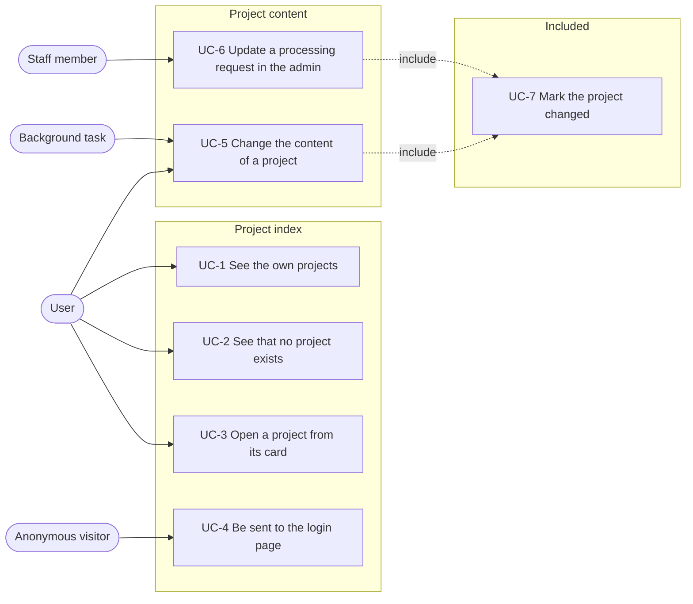
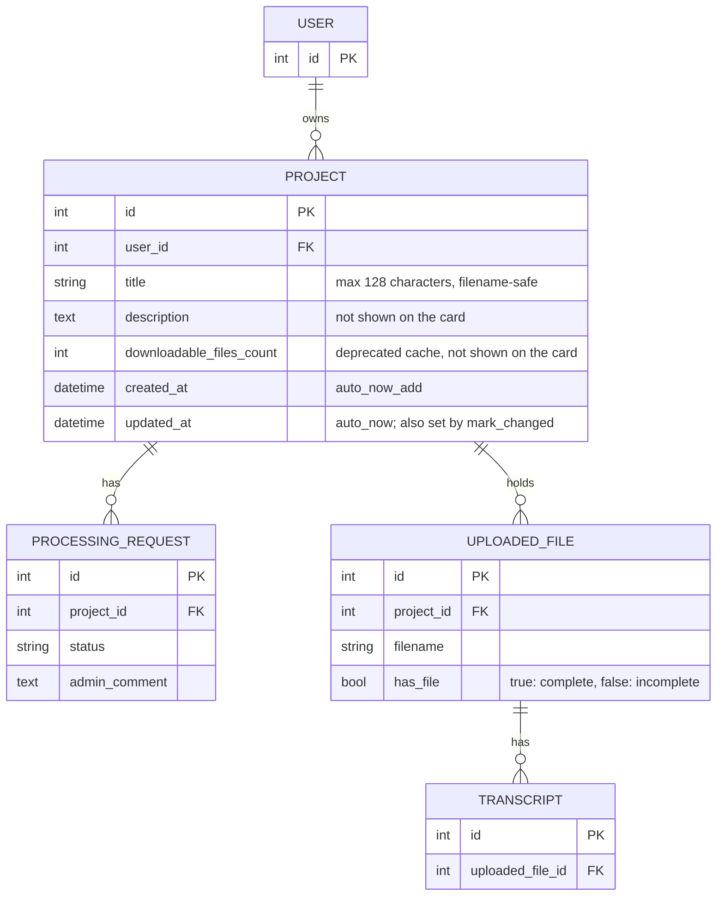
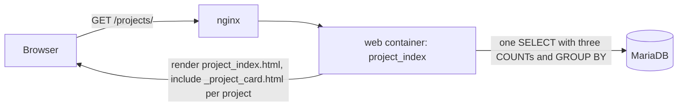
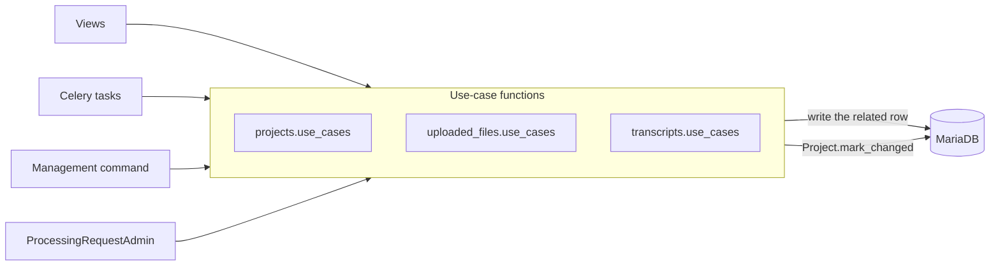

# Spec: project cards on the project index

Status: slices 1 and 2 implemented, slices 3 to 7 not started. Extracted on
2026-10-12 from the code at commit `0eee5d4`; the decisions of slices 3 to 7
were added on the same day.

This document is an **executable spec** (spec-driven development): it is the
prompt an implementing session works from and the authoritative record of every
decision, not a background sketch. Resolve ambiguity by reading this document,
not by inventing; if a genuinely new decision comes up, write it into this
document as part of the task. Check off tasks (`[x]`, with date) as they land.
Do not duplicate CLAUDE.md conventions here.

Unlike the other specs, this one was first written after the implementation, to
record the behaviour as it existed. The behaviour described below is the target
after slice 7. Where it differs from the code at `0eee5d4`, the difference is
named in the section "Changes against 0eee5d4".

The architecture note is a section of this document, because the feature is one
view, two templates, one stylesheet, one model method and the use-case
functions that call it.

## Motivation

A user with several projects needs to see them at once and open one of them.
The project index at `/projects/` shows one card per project of the user. A card
identifies the project by its title, shows how many files and transcripts it
holds and when its content last changed, and is a single link to the project's
detail page.

"Last changed" covers the project itself and its content: its processing
requests, its uploaded files and their transcripts, including deletions. At
`0eee5d4`, `Project.updated_at` changes only when the project row is saved, and
the `updated_at` values of the related rows cannot record a deletion, because a
deleted row leaves no value behind. After this spec, `Project.updated_at` is
also set by every operation that changes the project's content, so it holds the
time of the last change of the project or its content, and the card shows it.

## Changes against 0eee5d4

1. **Layout.** The card had the title followed by a list of three lines:
   "Created at" with the date, the upload count and the download count. It now
   has two rows: the title, and below it the counts on the left and the date
   of the last change on the right, without a label. The creation date is no
   longer shown.
2. **File count.** The card counted every `UploadedFile` row as "uploads",
   including uploads that had not finished. It now counts complete files as
   "files", and appends the number of incomplete files as `(+n)` when there are
   any. A project without any file shows "No files yet".
3. **Transcript count.** New. The card shows the number of transcripts of the
   project's files, when there is at least one.
4. **Download count.** The card no longer shows the download count. The field
   `Project.downloadable_files_count` stays in the model and is marked for
   future removal.
5. **Order.** Since the upload count was annotated in 2.17.1, the query groups
   by project, and Django leaves out `Meta.ordering` in grouped queries
   (`django/db/models/sql/compiler.py`, `if self._meta_ordering: order_by =
   None`). The cards have therefore been in an unspecified order, in practice
   oldest first, since 2.17.1. Before, the order was newest created first. The
   view now sets the order with an explicit `order_by('-updated_at')`: the
   project changed most recently comes first, consistent with the date the card
   shows.
6. **Content changes update the project.** New method
   `Project.mark_changed()`, which sets `updated_at`. The operations listed in
   "Operations that change the project" call it. Most of these operations were
   written directly in views; each one moves into a use-case function, which
   makes the call.
7. **Opening a project no longer counts as a change.** The project detail
   view saved the whole project row on every `GET`, to store
   `downloadable_files_count`, and so set `updated_at`. It now saves with
   `update_fields=['downloadable_files_count']`, which writes that column only
   and leaves `updated_at` unchanged.
8. **Styles.** The `.card` component changes its border colour to dark gray
   on hover and focus, on every page that uses it. The project card has a
   padding of `1rlh` on all four sides instead of `0.5rlh 1rlh`. The space
   between the title and the second row is `0.25rlh` instead of `0.5rlh`. The
   title of every card, on the project index and on the welcome page, is one
   line cut with an ellipsis, instead of at most two lines.
9. **Grid.** The project index uses the existing `.grid--default`, which has 1
   column below a container width of `40em` and 2 columns from `40em`, instead
   of `.grid--project` with up to 4 columns. `.grid--project` is removed.

## Non-goals

Do not add these, even where they would be easy:

- **No actions on the card.** The card has one link target. Rename, delete and
  settings are on the detail page and the settings page.
- **No description on the card.** `Project.description` is not shown.
- **No status on the card.** Processing requests, transcription jobs and the
  state of individual files are not summarised on the card, apart from the
  number of incomplete files.
- **No download count on the card.**
- **No explanation of the incomplete count.** `(+n)` is plain text, without a
  tooltip, a label or a link to the incomplete files.
- **No removal of `downloadable_files_count` in this spec.** The field, its
  admin columns and the code that writes it stay; the removal is a later change.
- **No new date field.** The date of the last change is `Project.updated_at`.
- **No derivation of the last change at read time.** The card does not compute
  a date from the `updated_at` values of related rows; it reads the project's
  own `updated_at`.
- **No signals.** `updated_at` is set by explicit calls in use-case functions,
  not by `post_save` or `post_delete` receivers.
- **No tracking of admin edits of uploaded files and transcripts.** Changes to
  uploaded files and transcripts made in the Django admin do not call the
  use-case functions and do not change the project's `updated_at`. Admin edits
  of a project save the project row and do change it; admin edits of a
  processing request call `update_processing_request` (UC-6).
- **No change history.** Only the time of the last change is stored, not what
  changed or who changed it.
- **No sorting, filtering, search or pagination.** The index shows every
  project of the user in one fixed order.
- **No projects of other users.** The index shows the authenticated user's
  projects only, superuser included. The admin is the place to see all projects.
- **No permission check beyond login.** The index requires a logged-in user and
  no model permission.
- **No client-side code.** The card is server-rendered HTML and CSS; there is no
  JavaScript and no Vue component for it.
- **No test for the number of queries.** The index uses one query (see the
  architecture note); this is not asserted by a test.

## Actors

- **User** — a logged-in account holder. The actor in UC-1 to UC-3 and UC-5.
- **Anonymous visitor** — a browser without a session. The actor in UC-4.
- **Staff member** — a user with access to the Django admin. The actor in UC-6.
- **Background task** — a Celery task that assembles an upload or stores a
  transcript produced by the ASR or NER service, or a management command that
  removes partial uploads. A system actor in UC-5.

## System use cases



Each use case below is the authoritative description of one system behaviour.
The feature reference further down repeats the rules in a compact form; where
the two disagree, the feature reference is wrong and both are fixed together.

### UC-1 See the own projects

- **Actor:** User.
- **Precondition:** The user is logged in and owns at least one project.
- **Trigger:** `GET /projects/`, reached from the "Projects" navigation link,
  the breadcrumbs or the projects card on the welcome page.
- **Main flow:**
  1. The view selects the user's projects in one query, ordered by
     `updated_at` with the most recent first, with the number of complete
     files, the number of incomplete files and the number of transcripts
     annotated onto each row.
  2. The page renders the heading "Projects" and one card per project in that
     order.
  3. The first row of each card shows the title.
  4. The second row shows the summary on the left and the date of
     `Project.updated_at` on the right. The date has no label.
  5. The summary is built from `c`, the number of complete files, `i`, the
     number of incomplete files, and `t`, the number of transcripts:
     - If `c + i` is 0, the summary is `No files yet`.
     - Otherwise it starts with `{c} file` or `{c} files`. If `i > 0`,
       ` (+{i})` follows.
     - If `t > 0`, ` · {t} transcript` or ` · {t} transcripts` follows.
       If `t` is 0, nothing follows and there is no separator.

     Examples: `No files yet`; `2 files`; `2 files (+1)`; `0 files (+1)`;
     `2 files · 1 transcript`; `2 files (+1) · 3 transcripts`.
  6. Below the cards, the link "Create a new project" leads to
     `/projects/create/`.
- **Postcondition:** No data is written.

### UC-2 See that no project exists

- **Actor:** User.
- **Precondition:** The user is logged in and owns no project.
- **Trigger:** `GET /projects/`.
- **Main flow:**
  1. The page renders the heading and the text "You have no projects yet." in
     place of the card grid.
  2. The link "Create a new project" is shown as in UC-1.

### UC-3 Open a project from its card

- **Actor:** User.
- **Precondition:** UC-1 has rendered the index.
- **Trigger:** The user activates a card by pointer or keyboard.
- **Main flow:** The browser follows the card's link to `/projects/<id>/`.
  Rendering the detail page writes `downloadable_files_count` and does not
  change `updated_at`.
- **Alternative flow:** While the pointer is over a card, or the card's link
  has the focus, the card changes its background, gains a shadow and
  underlines its title. This is visual feedback only.

### UC-4 Be sent to the login page

- **Actor:** Anonymous visitor.
- **Trigger:** `GET /projects/` without a session.
- **Main flow:** The response is a redirect to
  `/accounts/login/?next=/projects/`.

### UC-5 Change the content of a project

- **Actor:** User, or a background task.
- **Trigger:** One of the operations in the table "Operations that change the
  project" that writes a related row.
- **Main flow:**
  1. The view, task or command calls the operation's use-case function.
  2. The function performs the change.
  3. The function includes UC-7 for the project the changed row belongs to.
- **Postcondition:** `updated_at` of the project is the time of the change. The
  next rendering of the index shows that date and places the project first.

### UC-6 Update a processing request in the admin

- **Actor:** Staff member.
- **Trigger:** Saving the change form of a processing request in the Django
  admin, with any change to `status` or `admin_comment`.
- **Main flow:**
  1. `ProcessingRequestAdmin.save_model` calls `update_processing_request`
     with the request and the names of the changed fields.
  2. The function saves the request and includes UC-7.
  3. If `status` is among the changed fields, the function queues
     `send_processing_request_updated_email` for the request.
- **Alternative flow:** A change to `admin_comment` only marks the project
  changed and sends no email.

### UC-7 Mark the project changed

- **Actor:** Included by UC-5 and UC-6.
- **Main flow:** `Project.mark_changed()` writes the current time to
  `updated_at` with one `UPDATE` of that column, and sets the same value on the
  instance.
- **Postcondition:** Every other column of the project is unchanged.

## Entity relationship model



### Complete and incomplete files

A file is **complete** when `has_file` is true and **incomplete** when
`has_file` is false. In terms of `UploadedFile.status`:

| `status`     | Counted as |
|--------------|------------|
| `complete`   | complete   |
| `corrupt`    | complete   |
| `processing` | incomplete |
| `incomplete` | incomplete |
| `missing`    | incomplete |

A corrupt file is counted as complete, because the assembled file exists; the
checksum disagreement is shown on the detail page, not on the card.

### Transcripts

The transcript count is the number of `Transcript` rows whose uploaded file
belongs to the project, regardless of whether the file is complete. A file with
two transcripts contributes two.

### Derived values on the card

| Card value        | Source                                                         |
|-------------------|----------------------------------------------------------------|
| Title             | `Project.title`                                                |
| Date              | `Project.updated_at`                                           |
| Complete count    | `complete_files_count`, annotated, `has_file=True`             |
| Incomplete count  | `incomplete_files_count`, annotated, `has_file=False`          |
| Transcript count  | `transcripts_count`, annotated                                 |

### The last change

`Project.updated_at` holds the time of the last change of the project or its
content. It is written in two ways:

1. By every `save()` of the project row that does not name `update_fields`
   without `updated_at`, through `auto_now`. This covers creating the project,
   changing its title or description, deleting a downloadable file and editing
   the project in the admin. Each of these is a change of the project.
2. By `Project.mark_changed()`, called from the use-case functions of the
   operations that write a related row.

Because every full save of the project row moves the date, a write of a
technical field of `Project` that is not a change of the project must use
`save(update_fields=[...])` without `updated_at`, or `QuerySet.update`. The
project detail view's write of `downloadable_files_count` is such a write.

#### Operations that change the project

| Operation                          | Function                                      | Module                          | Called from                                                        |
|------------------------------------|-----------------------------------------------|---------------------------------|--------------------------------------------------------------------|
| Change title or description        | `update_project_title` (existing, unchanged)  | `mmt/projects/use_cases.py`     | `project_settings`; `project.save()` sets `updated_at`              |
| Delete a downloadable file         | `download_detail`, `POST` branch (unchanged)  | `mmt/projects/views.py`         | `project.save()` sets `updated_at`                                  |
| Create a processing request        | `create_processing_request` (new)             | `mmt/projects/use_cases.py`     | `processing_request_create`                                        |
| Update a processing request        | `update_processing_request` (new)             | `mmt/projects/use_cases.py`     | `ProcessingRequestAdmin.save_model`                                |
| Delete a processing request        | `delete_processing_request` (new)             | `mmt/projects/use_cases.py`     | `processing_request_delete`                                        |
| Start an upload                    | `start_upload` (new)                          | `mmt/uploaded_files/use_cases.py` | `projects.views.create_uploaded_file`                            |
| Complete an upload                 | `UploadedFile.assemble_chunks` (existing)     | `mmt/uploaded_files/models.py`  | `task_assemble_chunks`                                             |
| Delete an uploaded file            | `delete_uploaded_file` (new)                  | `mmt/uploaded_files/use_cases.py` | `uploaded_files.views.delete`, `remove_partial_uploads` command  |
| Add a transcript                   | `add_transcript` (new)                        | `mmt/transcripts/use_cases.py` (new module) | `transcript_create` view, the ASR ingestion in `transcripts/tasks.py`, the NER result in `transcripts/tasks.py` |
| Update a transcript                | `update_transcript` (new)                     | `mmt/transcripts/use_cases.py`  | `transcripts.views.update`                                         |
| Delete a transcript                | `delete_transcript` (new)                     | `mmt/transcripts/use_cases.py`  | `transcripts.views.delete`                                         |

The first two operations save the project row and need no call to
`mark_changed()`. Every other function calls `mark_changed()` after its write
has succeeded, in the same transaction where the function uses one. A function
that raises before the write does not mark the project changed.

#### Operations that do not change the project

- Opening the project detail page. It writes `downloadable_files_count` with
  `update_fields`, which does not change `updated_at`.
- Storing the client checksum (`uploaded_files.views.update`). It is a step of
  the upload protocol; the completed upload is marked by `assemble_chunks`.
- Writes by background tasks with `QuerySet.update`: the assembling flag, the
  media type, the server checksum, the duration and the web video flag.
- The `normalize_transcripts` management command, which rewrites stored
  content into the current format without a change in meaning.
- State changes of transcription jobs and entity extraction jobs. The
  transcript a job produces is marked by `add_transcript`.
- Edits of uploaded files and transcripts in the Django admin.
- Deleting the project. No project remains whose date could change.

#### Existing projects

No migration is needed. The `updated_at` of an existing project keeps its
value until the next change. At `0eee5d4` it was set by the last opening of the
detail page, the last change of the title or description and the last deletion
of a download, so it approximates the last activity.

### The deprecated download count

`Project.downloadable_files_count` caches the number of files in the project's
download directory. It is written by the project detail view and by the
download deletion, and it is shown in the admin. After slice 7 nothing on the
user-facing pages reads it. The field keeps its writers and its admin columns,
and a comment on the field states that it is no longer shown to users and is to
be removed. Its removal, including the migration, the writers and the admin
columns, is a later change and not part of this spec.

### Invariants

1. For every card, the complete count plus the incomplete count equals the
   number of `UploadedFile` rows of the project.
2. A project without files has no transcripts, so "No files yet" never hides a
   transcript count.
3. The index never shows a project whose `user_id` differs from the requesting
   user's identifier.
4. Rendering the index writes nothing to the database.
5. Opening the project detail page does not change `updated_at`.
6. `mark_changed()` writes `updated_at` and no other column.

## Architecture note

### Request path



### Write path of the last change



### Why explicit calls from use-case functions

Three designs were considered for propagating a change of a related row to the
project.

1. **Derived at read time.** The index computes the greatest `updated_at` of
   the project, its processing requests, files and transcripts with
   correlated subqueries. It cannot see deletions, because a deleted row leaves
   no `updated_at` behind, so every delete path would still have to write to
   the project.
2. **Signal receivers.** `post_save` and `post_delete` receivers in one module
   write the project's date. This is the mechanism behind Rails'
   `belongs_to ..., touch: true`, which Django does not provide. The rule is in
   one place, but it runs implicitly at every save and delete, including
   cascades, and `QuerySet.update` and bulk operations bypass it.
3. **Explicit calls from use-case functions (chosen).** Each operation that
   changes the project's content is one function, and that function calls
   `mark_changed()`. Views, tasks and the admin call the function and do not
   know the rule. The rule is visible at the place where the operation is
   defined, and each function is tested for it.

Design 3 required moving the writes out of the views into use-case functions,
which is the larger part of the work and is spread over slices 4 to 6. The
resulting functions are also the place for later rules that apply to every
change of a project's content.

### Why `updated_at` and not a separate field

A separate field, `last_changed_at`, was considered. It would move only on
content changes, while `updated_at` moves on every full save of the project
row. Since the detail view saves with `update_fields`, the remaining full saves
are the creation, title and description changes, the download deletion and
admin edits of the project, and all of them are changes of the project. The
separate field would only protect the date against technical fields added to
`Project` later, which the rule in "The last change" covers. It is therefore
not added.

### Why `mark_changed()` uses `QuerySet.update`

`mark_changed()` writes the one column with
`Project.objects.filter(pk=self.pk).update(updated_at=now)` instead of
`self.save()`. A `save()` would write every field of the instance, which can
overwrite a concurrent change made through another instance. `QuerySet.update`
does not apply `auto_now`, so the function passes the time explicitly.

### Query cost

The index issues one query for the projects, with `LEFT OUTER JOIN` on the
uploaded files and on their transcripts, and `GROUP BY` on the project. The
number of queries does not grow with the number of projects. Before 2.17.1 the
count was taken once per card; the annotation replaced that.

The join on transcripts repeats each file row once per transcript of that file.
Every count is therefore `distinct=True`: the file counts count distinct file
identifiers and the transcript count counts distinct transcript identifiers.
Without `distinct`, a file with two transcripts would be counted twice.

Each operation that calls `mark_changed()` issues one additional `UPDATE` on
the project row. `updated_at` has no index; the index page sorts the projects
of one user, which are few.

### Ordering of grouped queries

Django leaves out `Meta.ordering` in a query that has a `GROUP BY`. Every
annotated aggregate adds one, so a query on `Project` with an aggregate has no
order unless it calls `order_by` itself. This is why the order is set in the
view and not left to the model.

### Template isolation

`project_index.html` includes `projects/_project_card.html` with
`project=project only`. The card template receives the project and nothing
else from the page context. A value the card needs must therefore be an
attribute or annotation of the project object, which keeps the data the card
depends on visible in the view's query.

### Shared card component

The visual card is the generic component in
[`card.css`](../app/assets/css/components/card.css), also used by the welcome
page with the modifier `card--special`. The project card uses `card--default`.
A change to the base `.card` rules changes both pages; the dark gray border on
hover and focus and the one-line title are such changes and apply to the
welcome cards too. `.card--project`, `.card__details` and `.card__date` are
used by the project card only.

## Feature reference

### Route

| Method | Path          | Name             | View            | Decorators                       |
|--------|---------------|------------------|-----------------|----------------------------------|
| GET    | `/projects/`  | `projects:index` | `project_index` | `require_GET`, `login_required`  |

Any other method receives `405`. An anonymous request receives a redirect to
the login page with `next` set (UC-4).

### Query

```python
(
    Project.objects.filter(user=request.user)
    .annotate(
        complete_files_count=Count(
            'uploaded_files',
            filter=Q(uploaded_files__has_file=True),
            distinct=True,
        ),
        incomplete_files_count=Count(
            'uploaded_files',
            filter=Q(uploaded_files__has_file=False),
            distinct=True,
        ),
        transcripts_count=Count('uploaded_files__transcript', distinct=True),
    )
    .order_by('-updated_at')
)
```

The annotation `uploaded_files_count` is replaced by the three annotations
above. `Transcript.uploaded_file` sets `related_query_name='transcript'`, so
the lookup is `uploaded_files__transcript`.

### Model

```python
# mmt/projects/models.py
class Project(TimestampedModel):
    ...
    def mark_changed(self) -> None:
        """Record that the content of the project has changed now.

        Called by the use-case functions that write a processing request, an
        uploaded file or a transcript of the project. Writes updated_at only.
        """
```

### Use-case functions

```python
# mmt/projects/use_cases.py
def create_processing_request(processing_request: ProcessingRequest) -> None:
    """Save a new processing request, mark its project changed and queue the
    notification email to the staff."""

def update_processing_request(
    processing_request: ProcessingRequest, changed_fields: list[str]
) -> None:
    """Save a processing request changed in the admin and mark its project
    changed. Queues the email to the user when 'status' is in changed_fields."""

def delete_processing_request(processing_request: ProcessingRequest) -> None:
    """Delete the processing request and mark its project changed. The caller
    has checked processing_request.deletable."""
```

```python
# mmt/uploaded_files/use_cases.py
def start_upload(
    project: Project, *, filename: str, media_type: str, size: int
) -> UploadedFile:
    """Create the uploaded file row for a new upload and mark the project changed.

    filename is the name the client sent. The function derives the stored name
    with storage_filename and appends the date suffix when the project already
    has a file with that stored name; this logic moves here from the view.
    """

def delete_uploaded_file(uploaded_file: UploadedFile) -> None:
    """Delete the file on disk and the row, and mark the project changed."""
```

```python
# mmt/uploaded_files/models.py
class UploadedFile:
    def assemble_chunks(self) -> None: ...
        # existing; calls self.project.mark_changed() inside the transaction
        # that sets has_file
```

```python
# mmt/transcripts/use_cases.py (new)
def add_transcript(transcript: Transcript) -> None:
    """Save a new transcript, request the editing media of its file and mark
    the project changed. transcript.uploaded_file is set by the caller."""

def update_transcript(transcript: Transcript, fields: list[str]) -> None:
    """Save the given fields and updated_at, and mark the project changed."""

def delete_transcript(transcript: Transcript) -> None:
    """Delete the transcript and mark the project changed."""
```

- `add_transcript` calls `ensure_transcript_editing_media`, which the
  `transcript_create` view and the ASR ingestion call today. For the NER
  result, the call is new; it enqueues nothing when the editing media exist,
  which is the case for every file that already has a transcript.
- `mmt/transcripts/use_cases.py` imports `mmt.uploaded_files.tasks` and is
  imported by `mmt/transcripts/tasks.py`. It does not import
  `mmt.transcripts.tasks`.
- The views keep their validation, permission checks, messages and redirects.
  Only the write and the call to `mark_changed()` move into the functions.

### Page markup

- Breadcrumb "Projects", heading `h1` "Projects".
- With projects: `div.grid-wrapper > ul.grid.grid--default`, one `li` per card.
- Without projects: `p.u-ll` "You have no projects yet.".
- Always: `a.button-link[data-testid="new-project-link"]` to `projects:create`.

### Card markup

```html
<li class="card card--default card--project">
  <a class="card__link" href="/projects/<id>/" data-testid="project-card">
    <h3 class="card__title">{title}</h3>
    <p class="card__details u-mt-tiny">
      <span data-testid="project-card-summary">{summary}</span>
      <time class="card__date" datetime="{updated_at|c}">{updated_at|SHORT_DATE_FORMAT}</time>
    </p>
  </a>
</li>
```

- The whole card is one anchor, so the entire card area is the click target and
  the anchor is the only focusable element.
- `data-testid="project-card"` is on the anchor, not on the `li`. Tests and the
  Selenium test select the anchor by it. `data-testid="project-card-summary"`
  is on the summary, so tests read the summary without the date.
- The title is auto-escaped by the template engine.
- The date uses `SHORT_DATE_FORMAT` of the active locale (Django's default:
  `m/d/Y` in English, `d.m.Y` in German); the `datetime` attribute uses ISO 8601.
- The counts are numerals, pluralised with `blocktranslate count`. The file
  phrase is pluralised over `c`; a `c` of 0 uses the plural form.
- The suffix ` (+{i})` and the separator ` · ` (a space, U+00B7 MIDDLE DOT, a
  space) are written in the template outside the translated strings. They are
  the same in every language and have no translation entry.
- There is no download count, no creation date and no label for the date on
  the card.

### Layout

The grid is sized by container queries on `.grid-wrapper`
(`container-type: inline-size`), not by viewport media queries:

| Container width | Columns |
|-----------------|---------|
| below 40em      | 1       |
| from 40em       | 2       |

These are the rules of the existing `.grid--default`, which no template used at
`0eee5d4`. `40em` is the boundary between the mobile and the desktop layout.
`.grid--project` and its container queries are removed from `grid.css`.

The gap between cards is `1rlh`.

### Card appearance

- Padding of the link: `1rlh` on all sides, set by
  `.card--project .card__link`. The base `.card__link` padding of
  `0.5rlh 1rlh` is unchanged, so the welcome cards keep it. The link inherits
  the text colour and has no underline.
- Title: bold, `1rem`, line height `1rlh`, one line. A title wider than the
  card is cut with an ellipsis. The base `.card__title` rule replaces the
  two-line clamp (`-webkit-box-orient`, `-webkit-line-clamp`,
  `display: -webkit-box`) with `display: block`, `overflow: hidden`,
  `text-overflow: ellipsis` and `white-space: nowrap`. This applies to the
  welcome cards too, whose titles are short. The full title is not repeated in
  a `title` attribute; it is in the document and is read by screen readers.
- Details row (`.card__details`): `display: flex`, `flex-wrap: wrap`,
  `column-gap: 1rlh`, `0.875rem`, line height `1rlh`, colour `--text-muted`,
  `margin-bottom: 0`. The list rules (`list-style-type`, `padding-left`) are
  removed, because the element is no longer a list. The space of `0.25rlh`
  above the row comes from the existing utility `u-mt-tiny` in the markup,
  which replaces `u-mt-small`; `.card__details` sets no `margin-top`.
- Date (`.card__date`): `margin-left: auto`, which places it at the right edge
  of the row. When the card is too narrow for the summary and the date on one
  line, the date wraps onto a second line and stays right-aligned.
- On `:hover` and `:focus-within`: background `--color-blue-92`, border colour
  `--color-gray-30` (`#4d4d4d`), a shadow, and an underlined title. The
  transition takes 125 ms and covers background colour, border colour and
  shadow. The border colour is set in the base `.card:hover, .card:focus-within`
  rule. The rules `.card--default:hover`, `.card--default:focus-within`,
  `.card--special:hover` and `.card--special:focus-within`, which set the
  border colour back to `--color-blue-81`, have the same specificity as the
  base rule and come after it, so they would override it; they are removed.

### Translations

| msgid                                  | German                                   | Source of msgid           |
|----------------------------------------|------------------------------------------|---------------------------|
| `Projects`                             | `Projekte`                               | shared                    |
| `%(counter)s file` / `files`           | `%(counter)s Datei` / `Dateien`          | card, new                 |
| `%(counter)s transcript` / `transcripts` | `%(counter)s Transkript` / `Transkripte` | card, new               |
| `No files yet`                         | `Noch keine Dateien`                     | card, new                 |
| `You have no projects yet.`            | `Sie haben noch keine Projekte.`         | index                     |
| `Create a new project`                 | `Neues Projekt erstellen`                | shared with welcome page  |

The entries `%(counter)s upload` / `uploads` and `%(counter)s download` /
`downloads` have no other user and are removed from `django.po` in slice 7.
`Created at` stays, because `TimestampedModel.created_at` uses it.

## File layout

```
app/mmt/projects/
    models.py                                 Project.mark_changed; deprecation
                                              comment on downloadable_files_count
    use_cases.py                              create_/update_/delete_processing_request
    views.py                                  project_index; project_detail saves
                                              with update_fields; processing request
                                              views call the use-case functions
    admin.py                                  ProcessingRequestAdmin.save_model calls
                                              update_processing_request
    urls.py                                   projects:index
    templates/projects/project_index.html     page, grid, empty state, create link
    templates/projects/_project_card.html     one card
    tests/test_project_card.py                summary, date and order
    tests/test_project_changes.py             mark_changed, detail view, download
                                              deletion, processing request operations
    tests/test_views.py                       index shows own projects, hides others, redirects
    tests/test_selenium.py                    opens a project through its card

app/mmt/uploaded_files/
    use_cases.py                              start_upload, delete_uploaded_file
    models.py                                 assemble_chunks marks changed
    views.py                                  delete calls delete_uploaded_file;
                                              transcript_create calls add_transcript
    management/commands/remove_partial_uploads.py  calls delete_uploaded_file
    tests/test_use_cases.py                   extended
    tests/test_assembly.py                    extended

app/mmt/transcripts/
    use_cases.py                              new: add_, update_, delete_transcript
    views.py                                  update and delete call the use cases
    tasks.py                                  ASR and NER results call add_transcript
    tests/test_use_cases.py                   new

app/assets/css/components/
    card.css                                  .card, .card--default, .card__*
    grid.css                                  .grid, .grid--default; .grid--project removed

locale/de/LC_MESSAGES/django.po
```

Key signature of the index:

```python
# mmt/projects/views.py
@require_GET
@login_required
def project_index(request) -> HttpResponse: ...
```

## Tests

A test of "marks the project changed" sets `updated_at` of the project to a
past day with `QuerySet.update` before the operation, and asserts after it that
the value read from the database is later than that day.

- `projects/tests/test_project_changes.py` (pytest style), new:
  - `mark_changed()` sets `updated_at` and does not overwrite a title written
    through another instance of the same project between loading and the call;
  - `GET` on the project detail page writes the current
    `downloadable_files_count` and leaves `updated_at` unchanged; before the
    request, `updated_at` is set to a past day and the stored count differs
    from the number of files in the download directory. This test fails
    against the code at `0eee5d4`;
  - deleting a downloadable file marks the project changed;
  - `create_processing_request` marks the project changed and queues
    `send_new_processing_request_email`;
  - `update_processing_request` with `['status']` marks the project changed
    and queues `send_processing_request_updated_email`; with
    `['admin_comment']` it marks the project changed and queues no email;
  - saving the admin change form of a processing request with a changed
    `admin_comment` marks the project changed (through `admin_client`);
  - `delete_processing_request` deletes the request and marks the project
    changed.
- `uploaded_files/tests/test_use_cases.py`, extended:
  - `start_upload` creates the row with the stored filename and marks the
    project changed;
  - `start_upload` with a filename that the project already has appends the
    date suffix (moved from the view's test, if one exists; otherwise new);
  - `delete_uploaded_file` removes the file on disk and the row, and marks the
    project changed.
- `uploaded_files/tests/test_assembly.py`, extended: `assemble_chunks` marks
  the project changed.
- `transcripts/tests/test_use_cases.py` (pytest style), new: `add_transcript`,
  `update_transcript` and `delete_transcript` each mark the project changed;
  `update_transcript` writes only the given fields.
- `projects/tests/test_project_card.py` (pytest style), rewritten. Each case
  asserts the full text of the element `project-card-summary`, with whitespace
  collapsed:
  - a project without files: `No files yet`;
  - a project with two complete files and no transcript: `2 files`;
  - a project with two complete files and one incomplete file: `2 files (+1)`;
  - a project with one incomplete file only: `0 files (+1)`;
  - a project with two complete files and one transcript: `2 files · 1 transcript`;
  - a project with one complete file that has two transcripts and one more
    complete file: `2 files · 2 transcripts`. This case fails if the counts are
    not distinct;
  - a project with `downloadable_files_count` set to 3: the card contains no
    text containing `download`;
  - a project whose `created_at` and `updated_at` are set to different days
    with `QuerySet.update`: the `datetime` attribute of the card's `time`
    element is the ISO 8601 form of `updated_at`;
  - two projects of the user, P1 inserted before P2, with `created_at` and
    `updated_at` set with `QuerySet.update` so that P1 has the later
    `created_at` and P2 the later `updated_at`: the card of P2 comes first.
    The expected order differs from both the primary key order and the
    creation order, so the test fails against the code at `0eee5d4` and
    against an `order_by('-created_at')`.
- `projects/tests/test_views.py` (`TestCase` style), unchanged — the index of
  the owner contains a card with the project's title and the create link; the
  index of another user contains no card; an anonymous request is redirected to
  the login page.
- `projects/tests/test_selenium.py`, unchanged — the end-to-end test navigates
  to the index and opens the project through the card's anchor.
- The existing view, task and command tests of the moved operations keep
  passing unchanged; they cover the behaviour that moves into the use-case
  functions.

The layout, the date's position and format, and the absence of a label are
presentational and are not tested.

## Slices and tasks

Each slice leaves the system working and independently deployable. Until
slice 7, no page shows the project's `updated_at`, so slices 3 to 6 change no
visible behaviour.

- [x] **1 Card on the index.** The index renders one card per project with the
  title, the creation date and both counts, linking to the detail page.
  Landed with the introduction of projects, before this spec.
- [x] **2 Card revision.** The "Created at" label, the title underline on hover
  and focus, the upload count as a query annotation (2026-07-26, `3afb96a`), and
  the two-line clamp of the title (2026-07-26, `3f8addb`). The annotation also
  removed the newest-first order of the cards; slice 7 sets an explicit order.
  Done when `test_project_card.py` passes. Released in 2.17.1.
- [ ] **3 `mark_changed` and the detail view.** `Project.mark_changed()`;
  `update_fields` on the save in `project_detail`.
  Done when the `mark_changed`, detail view and download deletion cases of
  `test_project_changes.py` pass.
- [ ] **4 Processing requests.** `create_processing_request`,
  `update_processing_request`, `delete_processing_request`; the two views and
  `ProcessingRequestAdmin.save_model` calling them.
  Done when the processing request cases of `test_project_changes.py` pass and
  the existing processing request tests pass unchanged.
- [ ] **5 Uploaded files.** `start_upload` with the filename logic moved from
  the view; `delete_uploaded_file`; the call in `assemble_chunks`; the view,
  the delete view and `remove_partial_uploads` calling them.
  Done when the extended `uploaded_files/tests/test_use_cases.py` and
  `test_assembly.py` pass and the existing upload and command tests pass
  unchanged.
- [ ] **6 Transcripts.** `mmt/transcripts/use_cases.py` with `add_transcript`,
  `update_transcript` and `delete_transcript`; `transcript_create`, the update
  and delete views, and the ASR and NER results in `transcripts/tasks.py`
  calling them.
  Done when `transcripts/tests/test_use_cases.py` passes and the existing
  transcript view and task tests pass unchanged.
- [ ] **7 Two-row card with file and transcript counts.** The three
  annotations and `order_by('-updated_at')` in `project_index`; the two-row
  markup with the summary and the right-aligned `updated_at` in
  `_project_card.html`; the `.card__details`, `.card__date` and
  `.card--project .card__link` rules, the one-line `.card__title`, the dark
  gray hover border and the removal of the modifier hover rules in `card.css`;
  `.grid--default` in `project_index.html` and the removal of `.grid--project`
  from `grid.css`; the deprecation comment on `downloadable_files_count`; the
  new translation entries, the removal of the upload and download entries from
  `django.po`, and `compilemessages`; the CHANGELOG entry, which covers slices
  3 to 7.
  Done when the rewritten `test_project_card.py` passes and the index in a
  development run shows the most recently changed project first, moves a
  project to the first place after a file of it is deleted, keeps the order
  when a project is only opened, shows `No files yet` for an empty project,
  `n files (+m) · k transcripts` for a project with an unfinished file and
  transcripts, and the date at the right edge of the second row.
