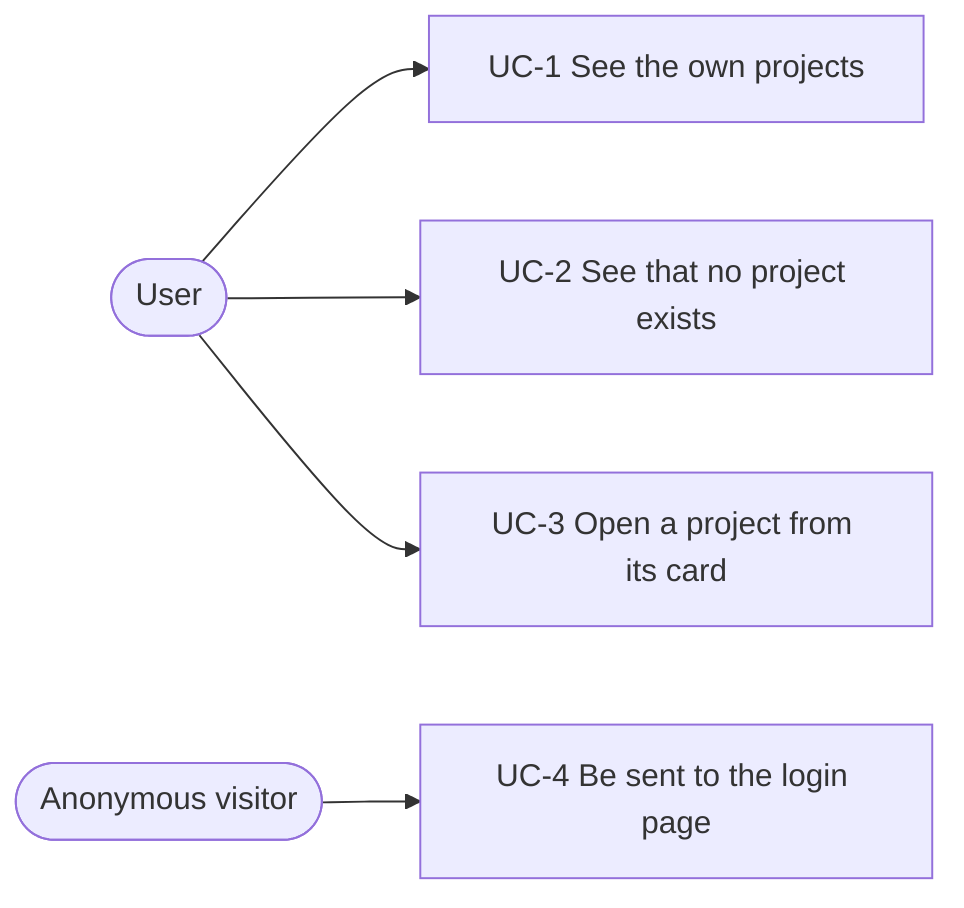

# Spec: project cards on the project index

Status: not started. Extracted on 2026-10-12 from the code at commit
`0eee5d4`, which implements the card before this spec's changes. Depends on
[`2026-10-12-project-content-changes.md`](2026-10-12-project-content-changes.md)
for the meaning of `Project.updated_at`; implement that spec first.

This document is an **executable spec**: it is the prompt an implementing
session works from and the authoritative record of every decision. Resolve
ambiguity by reading this document, not by inventing; if a genuinely new
decision comes up, write it into this document as part of the task. Check off
tasks (`[x]`, with date) as they land.

## Motivation

The project index at `/projects/` shows one card per project of the user. A
card identifies the project by its title, shows how many files and transcripts
it holds and when its content last changed, and links to the project's detail
page. The date and the order of the cards come from `Project.updated_at`.

## Non-goals

- No actions, description, status or download count on the card.
- No explanation of the incomplete count: `(+n)` is plain text.
- No removal of `downloadable_files_count`; it is marked for later removal.
- No sorting, filtering, search or pagination.
- No projects of other users, superuser included.
- No permission check beyond login.
- No client-side code.
- No test for the number of queries.

## System use cases



### UC-1 See the own projects

- **Actor:** User.
- **Precondition:** The user is logged in and owns at least one project.
- **Trigger:** `GET /projects/`.
- **Main flow:**
  1. The view selects the user's projects in one query, ordered by
     `updated_at` with the most recent first, with the number of complete
     files, the number of incomplete files and the number of transcripts
     annotated onto each row.
  2. The page renders the heading "Projects" and one card per project in that
     order.
  3. The first row of each card shows the title.
  4. The second row shows the summary on the left and the date of
     `updated_at` on the right. The date has no label.
  5. The summary is built from `c`, the number of complete files, `i`, the
     number of incomplete files, and `t`, the number of transcripts. A file is
     complete when `has_file` is true, which includes corrupt files.
     - If `c + i` is 0, the summary is `No files yet`.
     - Otherwise it starts with `{c} file` or `{c} files`. If `i > 0`,
       ` (+{i})` follows.
     - If `t > 0`, ` · {t} transcript` or ` · {t} transcripts` follows.
       If `t` is 0, nothing follows and there is no separator.

     `t` counts every transcript of every file of the project. Examples:
     `No files yet`; `2 files`; `2 files (+1)`; `0 files (+1)`;
     `2 files · 1 transcript`; `2 files (+1) · 3 transcripts`.
  6. Below the cards, the link "Create a new project" leads to
     `/projects/create/`.
- **Postcondition:** No data is written.

### UC-2 See that no project exists

- **Actor:** User.
- **Precondition:** The user is logged in and owns no project.
- **Trigger:** `GET /projects/`.
- **Main flow:** The page renders the heading, the text "You have no projects
  yet." in place of the card grid, and the link "Create a new project".

### UC-3 Open a project from its card

- **Actor:** User.
- **Trigger:** The user activates a card by pointer or keyboard.
- **Main flow:** The browser follows the card's link to `/projects/<id>/`.
- **Alternative flow:** While the pointer is over a card, or the card's link
  has the focus, the card changes its background and border colour, gains a
  shadow and underlines its title.

### UC-4 Be sent to the login page

- **Actor:** Anonymous visitor.
- **Trigger:** `GET /projects/` without a session.
- **Main flow:** The response is a redirect to
  `/accounts/login/?next=/projects/`. Any method other than `GET` receives
  `405`.

## Feature reference

### Query

```python
(
    Project.objects.filter(user=request.user)
    .annotate(
        complete_files_count=Count(
            'uploaded_files',
            filter=Q(uploaded_files__has_file=True),
            distinct=True,
        ),
        incomplete_files_count=Count(
            'uploaded_files',
            filter=Q(uploaded_files__has_file=False),
            distinct=True,
        ),
        transcripts_count=Count('uploaded_files__transcript', distinct=True),
    )
    .order_by('-updated_at')
)
```

- The annotation `uploaded_files_count` is replaced by these three.
- Every count is `distinct=True`, because the join on transcripts repeats each
  file row once per transcript.
- The `order_by` is required: Django leaves out `Meta.ordering` in a query
  with `GROUP BY`, so the cards have had no defined order since 2.17.1.

### Page markup

- Breadcrumb "Projects", heading `h1` "Projects".
- With projects: `div.grid-wrapper > ul.grid.grid--default`, one `li` per card.
- Without projects: `p.u-ll` "You have no projects yet.".
- Always: `a.button-link[data-testid="new-project-link"]` to `projects:create`.

### Card markup

```html
<li class="card card--default card--project">
  <a class="card__link" href="/projects/<id>/" data-testid="project-card">
    <h3 class="card__title">{title}</h3>
    <p class="card__details u-mt-tiny">
      <span data-testid="project-card-summary">{summary}</span>
      <time class="card__date" datetime="{updated_at|c}">{updated_at|SHORT_DATE_FORMAT}</time>
    </p>
  </a>
</li>
```

- The whole card is one anchor, and the anchor is the only focusable element.
- `data-testid="project-card"` is on the anchor. Tests and the Selenium test
  select the anchor by it. `data-testid="project-card-summary"` is on the
  summary, so tests read the summary without the date.
- The date uses `SHORT_DATE_FORMAT` of the active locale; the `datetime`
  attribute uses ISO 8601.
- The counts are numerals, pluralised with `blocktranslate count`. The file
  phrase is pluralised over `c`; a `c` of 0 uses the plural form.
- The suffix ` (+{i})` and the separator ` · ` (a space, U+00B7 MIDDLE DOT, a
  space) are written in the template outside the translated strings and have
  no translation entry.
- There is no download count, no creation date and no label for the date.

A comment on `Project.downloadable_files_count` states that it is no longer
shown to users and is to be removed.

### Layout

The grid is sized by container queries on `.grid-wrapper`
(`container-type: inline-size`):

| Container width | Columns |
|-----------------|---------|
| below 40em      | 1       |
| from 40em       | 2       |

These are the rules of the existing `.grid--default`. `.grid--project` and its
container queries are removed from `grid.css`. The gap between cards is `1rlh`.

### Card appearance

- Padding of the link: `1rlh` on all sides, set by
  `.card--project .card__link`. The base `.card__link` padding of
  `0.5rlh 1rlh` is unchanged, so the welcome cards keep it. The link inherits
  the text colour and has no underline.
- Title: bold, `1rem`, line height `1rlh`, one line. A title wider than the
  card is cut with an ellipsis. The base `.card__title` rule replaces the
  two-line clamp (`-webkit-box-orient`, `-webkit-line-clamp`,
  `display: -webkit-box`) with `display: block`, `overflow: hidden`,
  `text-overflow: ellipsis` and `white-space: nowrap`. This applies to the
  welcome cards too. The full title is not repeated in a `title` attribute.
- Details row (`.card__details`): `display: flex`, `flex-wrap: wrap`,
  `column-gap: 1rlh`, `0.875rem`, line height `1rlh`, colour `--text-muted`,
  `margin-bottom: 0`. The list rules (`list-style-type`, `padding-left`) are
  removed, because the element is no longer a list. The space of `0.25rlh`
  above the row comes from the utility `u-mt-tiny` in the markup;
  `.card__details` sets no `margin-top`.
- Date (`.card__date`): `margin-left: auto`, which places it at the right edge
  of the row. When the card is too narrow for the summary and the date on one
  line, the date wraps onto a second line and stays right-aligned.
- On `:hover` and `:focus-within`: background `--color-blue-92`, border colour
  `--color-gray-30`, a shadow, and an underlined title. The transition takes
  125 ms and covers background colour, border colour and shadow. The border
  colour is set in the base `.card:hover, .card:focus-within` rule, so it
  applies to the welcome cards too. The rules `.card--default:hover`,
  `.card--default:focus-within`, `.card--special:hover` and
  `.card--special:focus-within`, which set the border colour back to
  `--color-blue-81` and would override the base rule, are removed.

### Translations

| msgid                                    | German                                   |
|------------------------------------------|------------------------------------------|
| `%(counter)s file` / `files`             | `%(counter)s Datei` / `Dateien`          |
| `%(counter)s transcript` / `transcripts` | `%(counter)s Transkript` / `Transkripte` |
| `No files yet`                           | `Noch keine Dateien`                     |

The entries `%(counter)s upload` / `uploads` and `%(counter)s download` /
`downloads` have no other user and are removed from `django.po`.

## Tests

`projects/tests/test_project_card.py` (pytest style), rewritten. Each summary
case asserts the full text of `project-card-summary`, with whitespace
collapsed:

- no files: `No files yet`;
- two complete files, no transcript: `2 files`;
- two complete files and one incomplete file: `2 files (+1)`;
- one incomplete file only: `0 files (+1)`;
- two complete files and one transcript: `2 files · 1 transcript`;
- one complete file with two transcripts and one more complete file:
  `2 files · 2 transcripts` (fails if the counts are not distinct);
- `downloadable_files_count` set to 3: the card contains no text containing
  `download`;
- `created_at` and `updated_at` set to different days with `QuerySet.update`:
  the `datetime` attribute of the card's `time` element is the ISO 8601 form of
  `updated_at`;
- two projects, P1 inserted before P2, with P1 having the later `created_at`
  and P2 the later `updated_at`: the card of P2 comes first.

`projects/tests/test_views.py` and `test_selenium.py` stay unchanged.

## Slices and tasks

- [ ] **1 The card.** The query in `project_index`; the markup in
  `project_index.html` and `_project_card.html`; the CSS in `card.css` and
  `grid.css`; the comment on `downloadable_files_count`; the translations and
  `compilemessages`; the CHANGELOG entry, which also covers the content
  changes spec.
  Done when the rewritten `test_project_card.py` passes and the index in a
  development run shows the most recently changed project first, moves a
  project to the first place after a file of it is deleted, keeps the order
  when a project is only opened, and shows the summary and the date as in
  UC-1.
