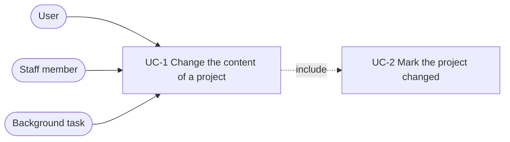

# Spec: project content changes update the project

Status: not started.

This document is an **executable spec**: it is the prompt an implementing
session works from and the authoritative record of every decision. Resolve
ambiguity by reading this document, not by inventing; if a genuinely new
decision comes up, write it into this document as part of the task. Check off
tasks (`[x]`, with date) as they land.

## Motivation

`Project.updated_at` changes only when the project row is saved. Adding,
changing or deleting a processing request, an uploaded file or a transcript
leaves it unchanged, so it cannot answer "when did this project last change".
The project cards ([`2026-10-12-project-cards.md`](2026-10-12-project-cards.md))
need that answer.

After this spec, `updated_at` holds the time of the last change of the project
or its content, including deletions. It is set by every full save of the
project row, as before, and in addition by `Project.mark_changed()`, which the
`save()` and `delete()` methods of the three content models call.

The rule is placed in the content models so that no caller has to know it:
every view, task, command and admin form that saves or deletes a content row
marks the project changed without further code. Three other designs were
considered and rejected:

- One use-case function per operation that writes the row and calls
  `mark_changed()`. Most of these functions only wrap a `save()` or `delete()`
  call, and every caller still has to know that it must use the function
  instead of `save()` or `delete()`.
- Signals. They run implicitly, at a distance from the model they belong to.
- A separate date field, or a date derived at read time from the related rows.
  The first adds a second date that differs from `updated_at` only for
  technical writes; the second cannot see deletions.

## Non-goals

- No new date field and no derivation of the date from related rows.
- No signals and no new use-case functions.
- No distinction between a change by a user and a technical write: a write
  through `save()` counts as a change, whoever makes it.
- No change history: what changed and who changed it are not stored.

## System use cases



A background task is a Celery task or a management command.

### UC-1 Change the content of a project

- **Actor:** User, staff member in the Django admin, or a background task.
- **Trigger:** A call of `save()` or `delete()` on a `ProcessingRequest`, an
  `UploadedFile` or a `Transcript`.
- **Main flow:**
  1. The model method performs the write.
  2. The model method includes UC-2, in the same transaction as the write.
- **Postcondition:** `updated_at` of the project is the time of the change.
- **Exceptions:** `QuerySet.update` and `QuerySet.delete` do not call the model
  methods and do not mark the project changed. This includes the rows that a
  cascade deletes, for example the transcripts of a deleted uploaded file; the
  delete of the uploaded file itself marks the project changed.

### UC-2 Mark the project changed

- **Main flow:** `Project.mark_changed()` runs
  `Project.objects.filter(pk=self.pk).update(updated_at=now)` and sets the same
  value on the instance. It does not use `save()`, which would write every
  field of the instance and could overwrite a concurrent change.
- **Postcondition:** Every other column of the project is unchanged.

### What counts as a change

Writes that change the project:

- Every full save of the project row: the title or description in the project
  settings, the deletion of a downloadable file, an edit in the admin.
- Every `save()` and `delete()` of a processing request, an uploaded file or a
  transcript, with or without `update_fields`. This includes writes that are
  technical, such as storing the client checksum, setting the assembling flag,
  `UploadedFile.update_has_file_field` and the `normalize_transcripts`
  management command. Marking the project changed for these writes is accepted.

Writes that do not change the project:

- Opening the project detail page. At `0eee5d4` the view saves the whole
  project row on every `GET` to store `downloadable_files_count`; it changes
  to `save(update_fields=['downloadable_files_count'])`.
- Writes with `QuerySet.update`: the media type, the server checksum, the
  duration and the web video flag, which background tasks write.
- State changes of transcription jobs and entity extraction jobs, which are
  other models.

A write of a technical field of `Project` that is not a change of the project
must use `save(update_fields=[...])` without `updated_at`, or
`QuerySet.update`. Existing projects keep their `updated_at`; no migration is
needed.

## Signatures

```python
# mmt/projects/models.py
class Project(TimestampedModel):
    def mark_changed(self) -> None:
        """Record that the content of the project has changed now.

        Called by save() and delete() of the processing requests, uploaded
        files and transcripts of the project. Writes updated_at only.
        """

class ProcessingRequest(TimestampedModel):
    def save(self, *args, **kwargs) -> None: ...
    def delete(self, *args, **kwargs): ...
```

```python
# mmt/uploaded_files/models.py
class UploadedFile(TimestampedModel):
    def save(self, *args, **kwargs) -> None: ...
    def delete(self, *args, **kwargs): ...
```

```python
# mmt/transcripts/models.py
class Transcript(TimestampedModel):
    def save(self, *args, **kwargs) -> None: ...
    def delete(self, *args, **kwargs): ...
```

- Each override runs the inherited method and then `mark_changed()` on the
  project inside one `transaction.atomic()` block, and passes all arguments
  through. `delete()` returns the value of the inherited method.
- `ProcessingRequest` and `UploadedFile` reach the project as `self.project`,
  `Transcript` as `self.uploaded_file.project`.
- Callers do not change. The views, tasks, commands and admin classes keep
  calling `save()` and `delete()` as they do at `0eee5d4`.

## Tests

A test of "marks the project changed" sets `updated_at` of the project to a
past day with `QuerySet.update` before the operation, and asserts after it that
the value read from the database is later than that day.

- `projects/tests/test_project_changes.py` (pytest style), new:
  - `mark_changed()` sets `updated_at` and does not overwrite a title written
    through another instance of the same project between loading and the call;
  - `GET` on the project detail page writes the current
    `downloadable_files_count` and leaves `updated_at` unchanged; before the
    request, the stored count differs from the number of files in the download
    directory;
  - deleting a downloadable file marks the project changed;
  - creating, saving and deleting a processing request each mark the project
    changed.
- `uploaded_files/tests/test_uploaded_file.py`, extended: creating, saving and
  deleting an uploaded file each mark the project changed.
- `transcripts/tests/test_models.py` (pytest style), new:
  creating, saving and deleting a transcript each mark the project changed.
- The existing view, task, command and admin tests keep passing unchanged.

## Slices and tasks

Each slice leaves the system working and independently deployable. No page
shows the project's `updated_at` until the project cards spec is implemented,
so no slice changes visible behaviour.

- [ ] **1 `mark_changed` and the detail view.** `Project.mark_changed()`;
  `update_fields` on the save in `project_detail`.
  Done when the `mark_changed`, detail view and download deletion cases of
  `test_project_changes.py` pass.
- [ ] **2 Content models.** The `save()` and `delete()` overrides of
  `ProcessingRequest`, `UploadedFile` and `Transcript`.
  Done when the processing request cases of `test_project_changes.py`, the
  uploaded file cases and the transcript cases pass, and the full suite passes
  without changes to existing tests.
