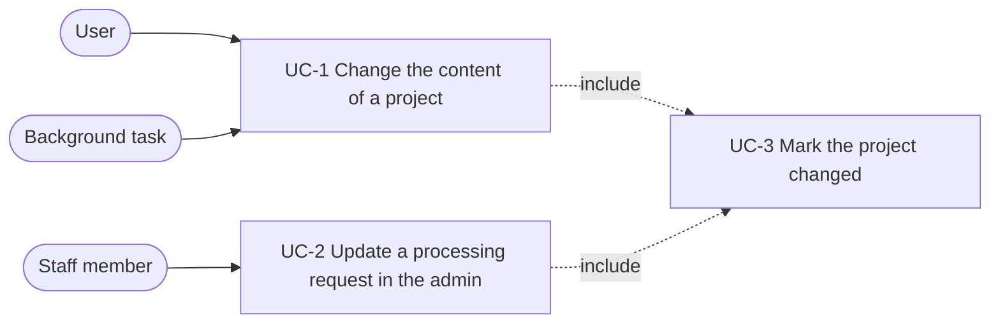

# Spec: project content changes update the project

Status: not started.

This document is an **executable spec**: it is the prompt an implementing
session works from and the authoritative record of every decision. Resolve
ambiguity by reading this document, not by inventing; if a genuinely new
decision comes up, write it into this document as part of the task. Check off
tasks (`[x]`, with date) as they land.

## Motivation

`Project.updated_at` changes only when the project row is saved. Adding,
changing or deleting a processing request, an uploaded file or a transcript
leaves it unchanged, so it cannot answer "when did this project last change".
The project cards ([`2026-10-12-project-cards.md`](2026-10-12-project-cards.md))
need that answer.

After this spec, `updated_at` holds the time of the last change of the project
or its content, including deletions. It is set by every full save of the
project row, as before, and in addition by `Project.mark_changed()`, which
every operation that writes a related row calls from its use-case function.

Signals and a separate date field were considered and rejected: signals run
implicitly and are bypassed by `QuerySet.update`, and a separate field adds a
second date that differs from `updated_at` only for technical writes, which
the rule at the end of "The operations" excludes. A date derived at read time
from the related rows cannot see deletions.

## Non-goals

- No new date field and no derivation of the date from related rows.
- No signals.
- No tracking of admin edits of uploaded files and transcripts.
- No change history: what changed and who changed it are not stored.

## System use cases



The background task is a Celery task that assembles an upload or stores an ASR
or NER result, or the `remove_partial_uploads` management command.

### UC-1 Change the content of a project

- **Actor:** User, or a background task.
- **Trigger:** One of the operations in the table below that writes a related
  row.
- **Main flow:**
  1. The view, task or command calls the operation's use-case function.
  2. The function performs the change.
  3. The function includes UC-3 after the write has succeeded, in the same
     transaction where the function uses one.
- **Postcondition:** `updated_at` of the project is the time of the change.

### UC-2 Update a processing request in the admin

- **Actor:** Staff member.
- **Trigger:** Saving the change form of a processing request in the Django
  admin.
- **Main flow:**
  1. `ProcessingRequestAdmin.save_model` calls `update_processing_request`
     with the request and `form.changed_data`.
  2. The function saves the request and includes UC-3.
  3. If `status` is among the changed fields, the function queues
     `send_processing_request_updated_email` for the request.
- **Alternative flow:** A change to `admin_comment` only marks the project
  changed and sends no email.

### UC-3 Mark the project changed

- **Main flow:** `Project.mark_changed()` runs
  `Project.objects.filter(pk=self.pk).update(updated_at=now)` and sets the same
  value on the instance. It does not use `save()`, which would write every
  field of the instance and could overwrite a concurrent change.
- **Postcondition:** Every other column of the project is unchanged.

### The operations

Operations that change the project:

| Operation                   | Function                                      | Module                            | Called from                                     |
|-----------------------------|-----------------------------------------------|-----------------------------------|-------------------------------------------------|
| Change title or description | `update_project_title` (existing, unchanged)  | `mmt/projects/use_cases.py`       | `project_settings`; its `save()` sets `updated_at` |
| Delete a downloadable file  | `download_detail`, `POST` (unchanged)         | `mmt/projects/views.py`           | its `save()` sets `updated_at`                  |
| Create a processing request | `create_processing_request` (new)             | `mmt/projects/use_cases.py`       | `processing_request_create`                     |
| Update a processing request | `update_processing_request` (new)             | `mmt/projects/use_cases.py`       | `ProcessingRequestAdmin.save_model`             |
| Delete a processing request | `delete_processing_request` (new)             | `mmt/projects/use_cases.py`       | `processing_request_delete`                     |
| Start an upload             | `start_upload` (new)                          | `mmt/uploaded_files/use_cases.py` | `projects.views.create_uploaded_file`           |
| Complete an upload          | `UploadedFile.assemble_chunks` (existing)     | `mmt/uploaded_files/models.py`    | `task_assemble_chunks`                          |
| Delete an uploaded file     | `delete_uploaded_file` (new)                  | `mmt/uploaded_files/use_cases.py` | `uploaded_files.views.delete`, `remove_partial_uploads` |
| Add a transcript            | `add_transcript` (new)                        | `mmt/transcripts/use_cases.py` (new) | `transcript_create`, ASR and NER results in `transcripts/tasks.py` |
| Update a transcript         | `update_transcript` (new)                     | `mmt/transcripts/use_cases.py`    | `transcripts.views.update`                      |
| Delete a transcript         | `delete_transcript` (new)                     | `mmt/transcripts/use_cases.py`    | `transcripts.views.delete`                      |

The first two save the project row and need no call to `mark_changed()`; every
other function calls it. Editing a project in the admin also saves the row and
counts as a change.

Operations that do not change the project:

- Opening the project detail page. At `0eee5d4` the view saves the whole
  project row on every `GET` to store `downloadable_files_count`; it changes
  to `save(update_fields=['downloadable_files_count'])`.
- Storing the client checksum (`uploaded_files.views.update`).
- Writes by background tasks with `QuerySet.update`: the assembling flag, the
  media type, the server checksum, the duration and the web video flag.
- The `normalize_transcripts` management command.
- State changes of transcription jobs and entity extraction jobs.
- Edits of uploaded files and transcripts in the Django admin.

A write of a technical field of `Project` that is not a change of the project
must use `save(update_fields=[...])` without `updated_at`, or
`QuerySet.update`. Existing projects keep their `updated_at`; no migration is
needed.

## Signatures

```python
# mmt/projects/models.py
class Project(TimestampedModel):
    def mark_changed(self) -> None:
        """Record that the content of the project has changed now.

        Called by the use-case functions that write a processing request, an
        uploaded file or a transcript of the project. Writes updated_at only.
        """
```

```python
# mmt/projects/use_cases.py
def create_processing_request(processing_request: ProcessingRequest) -> None:
    """Save a new processing request, mark its project changed and queue the
    notification email to the staff."""

def update_processing_request(
    processing_request: ProcessingRequest, changed_fields: list[str]
) -> None:
    """Save a processing request changed in the admin and mark its project
    changed. Queues the email to the user when 'status' is in changed_fields."""

def delete_processing_request(processing_request: ProcessingRequest) -> None:
    """Delete the processing request and mark its project changed. The caller
    has checked processing_request.deletable."""
```

```python
# mmt/uploaded_files/use_cases.py
def start_upload(
    project: Project, *, filename: str, media_type: str, size: int
) -> UploadedFile:
    """Create the uploaded file row for a new upload and mark the project changed.

    filename is the name the client sent. The function derives the stored name
    with storage_filename and appends the date suffix when the project already
    has a file with that stored name; this logic moves here from the view.
    """

def delete_uploaded_file(uploaded_file: UploadedFile) -> None:
    """Delete the file on disk and the row, and mark the project changed."""
```

`UploadedFile.assemble_chunks` calls `self.project.mark_changed()` inside the
transaction that sets `has_file`.

```python
# mmt/transcripts/use_cases.py (new)
def add_transcript(transcript: Transcript) -> None:
    """Save a new transcript, request the editing media of its file and mark
    the project changed. transcript.uploaded_file is set by the caller."""

def update_transcript(transcript: Transcript, fields: list[str]) -> None:
    """Save the given fields and updated_at, and mark the project changed."""

def delete_transcript(transcript: Transcript) -> None:
    """Delete the transcript and mark the project changed."""
```

- `add_transcript` calls `ensure_transcript_editing_media`. For the NER
  result the call is new; it enqueues nothing when the editing media exist.
- `mmt/transcripts/use_cases.py` imports `mmt.uploaded_files.tasks` and is
  imported by `mmt/transcripts/tasks.py`. It does not import
  `mmt.transcripts.tasks`.
- The views keep their validation, permission checks, messages and redirects.
  Only the write and the call to `mark_changed()` move into the functions.

## Tests

A test of "marks the project changed" sets `updated_at` of the project to a
past day with `QuerySet.update` before the operation, and asserts after it that
the value read from the database is later than that day.

- `projects/tests/test_project_changes.py` (pytest style), new:
  - `mark_changed()` sets `updated_at` and does not overwrite a title written
    through another instance of the same project between loading and the call;
  - `GET` on the project detail page writes the current
    `downloadable_files_count` and leaves `updated_at` unchanged; before the
    request, the stored count differs from the number of files in the download
    directory;
  - deleting a downloadable file marks the project changed;
  - `create_processing_request` marks the project changed and queues
    `send_new_processing_request_email`;
  - `update_processing_request` with `['status']` marks the project changed
    and queues `send_processing_request_updated_email`; with
    `['admin_comment']` it marks the project changed and queues no email;
  - saving the admin change form of a processing request with a changed
    `admin_comment` marks the project changed (through `admin_client`);
  - `delete_processing_request` deletes the request and marks the project
    changed.
- `uploaded_files/tests/test_use_cases.py`, extended:
  - `start_upload` creates the row with the stored filename and marks the
    project changed;
  - `start_upload` with a filename that the project already has appends the
    date suffix (moved from the view's test, if one exists);
  - `delete_uploaded_file` removes the file on disk and the row, and marks the
    project changed.
- `uploaded_files/tests/test_assembly.py`, extended: `assemble_chunks` marks
  the project changed.
- `transcripts/tests/test_use_cases.py` (pytest style), new: `add_transcript`,
  `update_transcript` and `delete_transcript` each mark the project changed;
  `update_transcript` writes only the given fields.
- The existing view, task and command tests of the moved operations keep
  passing unchanged.

## Slices and tasks

Each slice leaves the system working and independently deployable. No page
shows the project's `updated_at` until the project cards spec is implemented,
so no slice changes visible behaviour.

- [ ] **1 `mark_changed` and the detail view.** `Project.mark_changed()`;
  `update_fields` on the save in `project_detail`.
  Done when the `mark_changed`, detail view and download deletion cases of
  `test_project_changes.py` pass.
- [ ] **2 Processing requests.** The three use-case functions; the two views
  and `ProcessingRequestAdmin.save_model` calling them.
  Done when the processing request cases of `test_project_changes.py` pass and
  the existing processing request tests pass unchanged.
- [ ] **3 Uploaded files.** `start_upload` with the filename logic moved from
  the view; `delete_uploaded_file`; the call in `assemble_chunks`; the view,
  the delete view and `remove_partial_uploads` calling them.
  Done when the extended `uploaded_files/tests/test_use_cases.py` and
  `test_assembly.py` pass and the existing upload and command tests pass
  unchanged.
- [ ] **4 Transcripts.** `mmt/transcripts/use_cases.py`; `transcript_create`,
  the update and delete views, and the ASR and NER results calling it.
  Done when `transcripts/tests/test_use_cases.py` passes and the existing
  transcript view and task tests pass unchanged.
